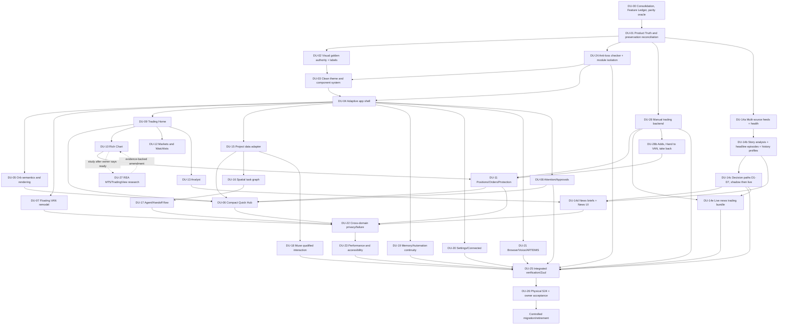

# VAN Tactile Spatial Experience — Complete Frontend Rebuild, Functional Preservation & Capability Expansion

**Document ID:** `VAN-TSE-FR-REV1.3-20261015`  
**Revision:** 1.3 — forensic-design specification / implementation programme candidate (supersedes Rev 1.2; Rev 1.0 is kept beside it for lineage, Rev 1.1–1.2 are in git history)  
**Date:** 15 October 2026 (Africa/Harare)  
**Owner instruction:** Recorded in `VAN_NEXT_OWNER_DECISIONS_REV1.md` (OD-00…OD-12), which captures the two locked dark/light references and the 15 October review decisions  
**Repository:** [`Vanguduza/Van`](https://github.com/Vanguduza/Van)  
**Audit baseline A:** merged `main` SHA `8eb1889822fc8a83f219977c15340172e16acd91`  
**Audit baseline B:** unmerged, draft owner-core [PR #93](https://github.com/Vanguduza/Van/pull/93) SHA `dfc1557ab99ad8d41cf84714e1bb671e89b045e6`  
**Status:** `FORENSIC_SOURCE_REVIEW_PARTIAL / BLUEPRINT_CANDIDATE / NOT_DEVICE_QUALIFIED / NOT_OWNER_ACCEPTED_FOR_IMPLEMENTATION`  
**Governing development method:** `DIAL-FFDRM-R1` / `DIAL_FABLE_FORENSIC_PREDEVELOPMENT_STANDARD` (F0–F15).  
**Governance:** Documentation does **not** modify Project Truth, owner grants, trading policy, deployment or protected branches; no green gate is implied by publication of this blueprint.  
**Companion artifacts:** `VAN_78_SURFACE_PRESERVATION_MATRIX_REV1_2_20261015.md` (78 surfaces + additive surfaces; CSV and JSON for automation), `VAN_NEXT_OWNER_DECISIONS_REV1.md`, `reference/` (locked originals and relabelled Rev 1.1 references).  

> **Executive decision:** Rebuild the entire visible frontend using the newly accepted Tactile Spatial UI, not the old VAN panels or older aesthetic blueprints; comprehensively inspect and preserve qualified product functions, underlying service/contracts, security, existing worthwhile UX flows, Floating VAN and interaction behaviours. Introduce the state-aware Home orb, small quick-access sheet, richer Trading entry points, full news intelligence, and genuinely live project/task/agent spatial workflow diagrams. Reconcile large, unmerged source candidates before porting; no silent legacy-file imports or feature loss.

## Rev 1.3 change log (15 October 2026)

| # | Change | Where |
|---|---|---|
| T3 | Owner decision OD-13 (resolves OQ-10): armed plans enter only after **both** sources have delivered the release figure and agree; the single-source speed mode is removed. | §8.10.3, §8.10.9 |
| T1 | **Live news trading bundle** (OD-12): a defined feed bundle (official release pages at the release second, a paid calendar with consensus, a paid text squawk with an API, pay-per-read X squawk accounts, free context feeds), armed plans for scheduled releases, whitelisted unscheduled-headline classes needing two fast sources, owner pre-signed armed tickets for one-tap news trades, a latency ledger, news-specific risk limits, and replay → paper → shadow → owner-signed promotion per event class. Honest latency tier: about 1–10 seconds, not institutional milliseconds. | §8.10 |
| T2 | Source research report added to the pack. | `research/FREE_TRADING_NEWS_AND_CALENDAR_FEEDS_20261015.md` |

## Rev 1.2 change log (15 October 2026)

Driven by the owner's second round of decisions (OD-07…OD-11) and a further code check.

| # | Change | Where |
|---|---|---|
| R1 | The stop is attached **inside the opening order**, so a manual trade is never open without it. Rev 1.1 described closing after the fill as if it were the mechanism; it is only the last-resort fallback, and Rev 1.2 adds re-attach attempts before any close. The venue adapters already do this (MT5 refuses orders without SL "in the same request"; cTrader sends `relativeStopLoss` in the same request). | §7.4.3, F-031 |
| R2 | Rev 1.1 said `OrderCommand` has no take-profit field; it has `targets`, which both adapters send as the TP in the same request. Corrected. | §7.4.4 |
| R3 | Adding to a winning manual trade works exactly like a new manual entry (same screen, same automatic stop), with risk judged on the whole position family. | §7.4.6 |
| R4 | **Hand to VAN**: switch a manual trade to automatic management, and take it back. | §7.4.7 |
| R5 | **Manual add to a winning automatic trade**, governed by that trade's own risk profile (strategy budget, scale policy, family envelope, temperament). | §7.4.6 |
| R6 | News rebuilt again: several independent live sources per category with cross-checking, full analysis, and **history comparison** using the event research engine that already exists on `main` (surprise, measured reactions, episodes, analogues), wired into actual trading decisions through defined, tested paths. | §8, F-032 |

## Rev 1.1 change log (15 October 2026)

Driven by an independent review of Rev 1.0 against the `Vanguduza/Van` checkout (main `8eb1889`, PR #93 `dfc1557`) and the owner's decisions on that review (`VAN_NEXT_OWNER_DECISIONS_REV1.md`).

| # | Change | Where |
|---|---|---|
| C1 | **Owner manual trading** designed: manual entries and exits run through the existing mandate, Risk Authority, pre-trade gate, router and protection; every manual entry carries a system-computed broker-side stop; take-profit optional. Replaces the one-tap "Place Order" in the mockup. | §0.2, §7.4, §14.3, DU-28 |
| C2 | Mockup labels changed to the system's own vocabulary; relabelled references published beside the untouched originals. | §2.6, `reference/` |
| C3 | Five Trading Home entry points confirmed as **owner-requested** (visual delta VD-02, not drift). | §0.2, §4.2, §7.1 |
| C4 | News plan rebuilt on the pipeline that already exists on `main` (`trading/vati/events/news_ingress.py` → ledger → `GET /v1/trading/events` → Android "Significant events"/"Linked events"); adds plain-language **News briefs** that state what the news does to trading. Rev 1.0's F-013 was wrong. | §3.2 F-013/F-026, §8 |
| C5 | **Repository consolidation is priority one.** 35 of 78 surfaces cite 53 files that exist only on unmerged PR #93. Consolidation, a feature ledger and a parity oracle precede new-UI work; a separate Gradle module keeps legacy UI out of the new frontend. | §3.2 F-027, §12.5, §12.6, §16.2, §19.1 |
| C6 | Coverage numbers aligned to the matrix (44 implemented / 33 partial / 1 external). | §3.2 F-022 |
| C7 | Dependency graph fixed: anti-loss contracts (DU-24) now gate the first new screen; Quick Hub depends on the domains it routes into. | §16.2 |
| C8 | Visual authority moved from "this conversation" to a repository record. | §2.1, §17 F0 |
| C9 | Smaller fixes: goldens are native renders, Home status line comes from the presence reducer, matrix route placeholders are nulls, mockup typo fixed. | §2.5, §2.6, §5.5, matrix |

---

## 0. Contract, scope and non-claims

### 0.1 Positive product outcome

VAN Next is one Android application with two photometrically and structurally consistent themes: warm silver/ivory and deep graphite. It feels machined, precisely assembled, softly elevated and high quality. One primary intent is visually dominant per screen. Its state and action system is live and accountable. The app makes complexity available in context, not permanently visible on Home. It is an AI command centre, professional trading workstation, project/agent control plane, personal assistant, automation portal and knowledge environment, **not** only a trading dashboard.

### 0.2 Requirements that cannot be thinned out

1. Both user-approved designs are visually locked; the only sanctioned changes are those explicitly approved by the owner or demanded by essential accessibility/operational correctness, followed by visual re-approval.
2. The orb is a realistic, sculpted metallic object; animation and state colour are subtle, semantically grounded and informative. No homepage state-key/legend.
3. One tap on the Home orb opens a deliberately **compact** read-only summary and navigation sheet; position performance, priority tasks, project progress, notifications and quick destinations appear as concise rows. It must **not** become a dashboard within a popup.
4. The global Trading Home visibly provides **Markets, Watchlist, Potential trades, Chart and Intelligence** entry points and a restrained equity/portfolio-heat context. The locked images show three of the five tiles; **Chart** and **Intelligence** tiles are an owner-requested addition (OD-03, visual delta VD-02), so the native golden includes them and this is not drift.
5. Dedicated Trading screens preserve professional live charts, indicators, position lines, SL/TP, depth where supported, history, orders and safe control paths; not all data is crammed onto one portrait page.
6. Intelligence has substantive **News** and **News Analysis** (OD-11): several independent live sources, cross-checked; macro/event context, provenance, contradicting evidence, affected instruments, relevant strategies/positions, timing and freshness; and **comparison with how similar past events actually moved the market**, which feeds real trading decisions through defined, tested paths (§8). A **live news trading bundle** lets VAN and the owner trade news as it breaks, within seconds, through pre-validated event strategies and armed plans (§8.10).
7. Projects/Tasks offer live spatial diagrams of phases, tasks, dependencies, agents, handoffs, blocked edges, evidence, completed work and current progress; a list alternative remains available.
8. Floating VAN retains meaningful gestures, modes, dialogue, voice, workboards, dock/minimise/recovery, contextual controls and system-wide usefulness. Re-skinning must not regress these capabilities.
9. Earlier blueprints are evidence and starting hypotheses, not immutable implementation strategies. Improvements found through validated research, including REA-assisted MT5/TradingView study **when separately ready**, can revise this blueprint. Trading and owner-authority changes still require their proper separate domain approval/evidence.
10. Architecture and product acceptance are different from implementation and production qualification. Never treat mockups, source-only tests, historical branch claims or this blueprint as a deployed result.
11. **Owner manual trading** (OD-01, OD-07…OD-10): the owner can open, add to and close trades manually. Manual entries are governed by the account's signed risk profile (mandate, per-strategy budget and, once admitted, trading temperament), always carry a **strict, automated, broker-side stop-loss attached inside the opening order**, and take an **optional take-profit**. Adding to a winning manual trade works like a new entry. A manual trade can be **handed to VAN** for automatic management and taken back. The owner can **add to a winning automatic trade**, governed by that trade's own risk profile. Manual exits reduce risk and stay available when new entries are blocked. Manual trading is a new origin into the existing VATI path, never a second execution path (§7.4).
12. **Consolidate before rebuilding** (OD-05): functions that exist on unmerged branches or are documented for porting are consolidated and inventoried before the new frontend replaces anything, so the rebuild cannot silently thin the product. The new frontend is built so legacy presentation code cannot leak into it (§12.5–§12.6).

### 0.3 Explicit exclusions

- No trading-policy amendment, broker activation, production order, live fund movement or privileged bypass is authorised by this design document. Manual trading (§7.4) needs its own owner-signed mandate version before any live use; the design does not grant it.
- No automatic merge of PR #93/#95/#97/#92/#70/#72/#77 or deletion of legacy source on the basis of visual preferences alone.
- No installation or running of REA on `van-trading-core` until the owner separately says that host is ready.
- No VPN, WireGuard, firewall, OCI/IAM, Cloudflare tunnel, host credentials, device pairing or release-signing changes in the frontend programme without distinct operational authorisation and evidence.
- No invented current balances, prices, performance, task counts, agent states, news, subscriptions, sources or completion percentages in shipping screens.
- No new standalone page merely because a capability exists. Preserve sheet, modal, inline, activity and intake semantics where those are safer or more coherent.

### 0.4 Evidence grades

`E0 OWNER_REFERENCE` — user text or locked visual; `E1 DOCUMENTED` — historic docs/audit; `E2 SOURCE_STATIC` — hashed inspected repository source; `E3 TEST_RECEIPT` — exact current-source test; `E4 RUNTIME_OBSERVED` — signed, current environment; `E5 DEVICE_CERTIFIED` — actual Android handset; `E6 OWNER_VISUALLY_ACCEPTED` — explicit dark/light acceptance. Lower grades never imply higher grades. New capability candidates are `SPEC_ONLY` until implementation evidence exists.

---

## 1. Evidence-based atomic audit methodology

### 1.1 Immutable source snapshots and exact boundary

| Item | Merged baseline | Draft source candidate |
|---|---|---|
| Source SHA | `8eb1889822fc8a83f219977c15340172e16acd91` | `dfc1557ab99ad8d41cf84714e1bb671e89b045e6` |
| Tracked files | 1,721 | 4,015 |
| Scanned readable text files | 1,567 | 1,216 **materialised subset** |
| Per-line hash/index entries | 344,642 | 536,019 **subset** |
| Parsed syntactic declarations | 4,859 | 5,720 **subset** |
| Source signal analysis | 14 categories | 10 categories |
| Scope | Entire current merged checkout, readable text | Sparse PR #93: Android, gateway, VATI, visual authority, registries, design docs and repo-root relevant files |
| Not covered by static scan | Binary images/compiled resources, dynamic execution, physical/live operation | Unmaterialised PR #93 generated/project-state docs, some services/deploy/tools and binary resources, dynamic/live operation |

Snapshot code was read on the qualified DIAL VM topology through Global DIAL MCP. The main repository and draft PR #93 were **independent isolated checkouts** on `van-trading-core`; production service units and their active checked-out sources were not altered. The real default branch was verified against GitHub before snapshotting. Original inspected source lines were SHA-256 fingerprinted with a per-file manifest and per-symbol location index. Pattern tags identify inspection targets; they are **not semantic proof** and not all matching lines are defects.

The main-source report records 406 lines matching broad hardcoded-style patterns, 462 matches for broad placeholder-like tokens and 216 probable composable declarations. These are **mechanical match counts**, not 406 UI violations, 462 real stubs or 216 qualified screens. In the PR #93 subset, 301 scanned text files were new relative to main, 205 modified and 710 identical. Definitions may be multiline, generated, delegated or dynamic; regex-based symbol counts are approximate. Only human-correlated findings below can drive replacement decisions.

### 1.2 Reproducible raw audit evidence on DIAL topology

**Merged-main analysis directory:** `/home/ubuntu/work/van-ui-audit-20261015/.audit-output/tactile-spatial-rebuild-20261015/`

| Artifact | Content | SHA-256 |
|---|---|---|
| `audit_receipt.json` | Source/scope/counts | `e8de593b40b6358dae15c28663d5873ab3b2911ecd3bcaed0c56437eb8cc3538` |
| `file_manifest.csv` | Text file hashes, sizes, counts, candidate dispositions and signal totals | `f593348126359feb0e05701386517a37b91b68d6745df8b97c7515779f80b4a3` |
| `symbol_inventory.csv` | Declarations with path, line, marker, source SHA | `eb7ee7043e869eb85a1328a844b842e88ae78d6c42d5043567121dc9d0065062` |
| `atomic_line_index.jsonl.gz` | Every materialised text line: file key, number, abbreviated line hash and broad signal tags | `7bc4ac79c86560ce6592dae7234c0f44ce8ce2cbdfc21dfd7dfe9c3a327fb528` |
| `screen_causal_registry.json` | 78 historical screen contracts, actions and source locations | `06ebb7d96e3880d16ab3e8383dd4b6472c8d0e5c672ebc668f2cfe4f6bcd1de2` |

**PR #93 subset analysis directory:** `/home/ubuntu/work/van-ui-audit-rev3-20261015/.audit-output/rev3-preservation-20261015/`

| Artifact | Content | SHA-256 |
|---|---|---|
| `rev3_receipt.json` | Branch, scope and comparison counts | `f1f19935552bd3d3ed65c298b91e35d78fb6f8039532feaa9861dcc6d407eb6d` |
| `rev3_file_manifest.csv` | Materialised source-by-source diff identity | `488b33ccac23489944ab632d96c4d99cc08737291c58867a0ce5e751ea25f779` |
| `rev3_symbols.csv` | Declaration locations | `2b89912f279594f3d0434869632e2cb7aee9546d795b5003b822209a4ab7802b` |
| `rev3_line_index.jsonl.gz` | Per-line hash/tags in materialised PR #93 scope | `ea1296edeadd97fa172e3a84c729380b003bc86a04b4053b93c55f93ad039dbe` |

These files remain in the isolated VM audit directories until explicitly published. Their paths are forensic receipt references, **not user-download links**. No test/semantic/owner acceptance is asserted by their presence. The separate `VAN_78_SURFACE_PRESERVATION_MATRIX_20261015.md` is a fully readable, downloadable audit supplement containing one clause per registered surface.

### 1.3 Supplied audit document scope

- `VAN_FRONTEND_SCREEN_REGISTRY_2026-10-09.md`: SHA-256 `1154876050f4b18de3ac8deb461871360c3831444a67c06b17c890fe37a8741f`. Exactly 78 distinct surfaces, 349 historical owner-action entries, 324 historical endpoint references and 428 source-reference entries were extracted. Its original audit observed source only; it is **not** a physical certification.
- `VAN_EXPERT_TRADING_TERMINAL_UX_BLUEPRINT_REV_1_1 (1).md`: SHA-256 `575c24de30ce265c5f006fb7fbef2cec7069b23f7498a1b2747d93b31b0dc3ff`. Contains proposed professional charting, VATI risk/execution ownership, Live Analyst, market/depth, replay and qualification. Treat as design input, not implemented state.
- Locked **dark** image: `1001273024.png`, SHA-256 `e3bca85b2c523bbb171048ec7947b40227f38766eec100e216c1d0643b456a17`.
- Locked **light** image: `1001273025.png`, SHA-256 `76662dca3ba69bc47e1f04d227e4d86aa90b9872adcf2f0e25aa907583c0a2b7`.
- Rev 1.1 relabelled references (labels only; composition, material and colour untouched): `reference/VAN_LOCKED_DARK_RELABELLED_REV1_1_20261015.png` SHA-256 `6d23cd44df038ae94f81d7ef753305e49254d2c73a3dc757b3eae24b94890770`; `reference/VAN_LOCKED_LIGHT_RELABELLED_REV1_1_20261015.png` SHA-256 `313e37b11e7bd258b194d20214eaaa7bd3e8c6fabfa77bee65732e984877cc64`. Produced by `reference/relabel_mockups.py` with `relabel_dark.json` / `relabel_light.json`, so the edit is reproducible from the originals.

### 1.4 Methodological limits that must not be hidden

This is a complete **mechanical, readable-line inventory of merged main**, a substantial bounded PR #93 source-line inventory, and a 78/78 historical surface-contract extraction. It is **not** a human semantic review of every one of hundreds of thousands of individual lines, nor a full forensic review of all 4,015 PR #93 files. The unfinished PR #93 docs/services/assets, runtime registration, live E2E testing, an independently adversarial second reviewer and physical certification are explicitly outstanding. Any claim of `FORENSIC_BUILD_READY` or `OWNER_ACCEPTED` must await those gates. The implementation roadmap incorporates that remaining audit closure as an initial development unit, not an invisible assumption.

---

## 2. Owner visual authority and anti-drift policy

### 2.1 Source hierarchy

1. **Recorded owner decisions** (`VAN_NEXT_OWNER_DECISIONS_REV1.md`) and the locked screenshots, as relabelled under §2.6, govern visual style, feature additions and product priorities. A chat transcript is not a durable authority; a decision that is not in the record is not yet binding on development packets. Under the VAN Project Truth Protocol an owner-signed instruction outranks this record, so the record is confirmed by owner signature before DU-02 freezes goldens.
2. Real operating security/financial/permission authority and source-backed operational truth remain binding functional constraints; a design document cannot silently mint execution authority.
3. Current immutable repository code, genuine runtime receipts, qualified existing services, current project/branch state and exact Android device evidence inform *functional reuse* and migration.
4. Current proven behavior and useful historic user flows are preservation candidates only after admission into a reuse register.
5. Older design/terminal/visual blueprints, historical audits and unmerged candidates are informative hypotheses and may be corrected, replaced or superseded after evidence-backed comparison.
6. Generic industry references are inspiration only; they cannot displace the locked designs or introduce unqualified execution semantics.

### 2.2 What is visually locked

**Theme identity:** same manufactured metallic orb, same sculpted material grammar, quiet lighting, calm hierarchy, negative space and professional labels. Dark is deep blue/graphite with subtle chrome and restrained soft-cyan glints; light is satin silver/off-white with charcoal readable typography, shallow natural shadows and icy-blue select accents. Components are physically dimensional, *not flat Material rectangles* and not neon-bordered dashboard cards.

**Composition:** Home orients around the orb and only a few concise previews; Trading Home is a compact financial overview and five capability entrances (three drawn in the locked art, two owner-added: VD-02); the instrument chart owns the space on the chart screen; position lists remain readable; Intelligence uses discrete actionable opportunities and research/News entry; Work/Projects organise agents and tasks through focused modules and interactive flow views. Micro-detail lives in next-level sheets and screens.

**Motion:** subtle rotation/glide/rim illumination and physically plausible shadow changes; gentle card rise/press depth; controlled spatial transitions. No constant full-screen bloom, random orbs, gratuitous particles, scroll-jacking, perpetual pulse for every card, or event-colour legend on Home.

### 2.3 Material system (initial engineering tokens, to be measured against goldens)

| Role | Dark baseline | Light baseline | Rules |
|---|---|---|---|
| Canvas | Blue-charcoal/graphite | Warm soft-white | Subtle atmosphere, never noisy gradient |
| Core material | Satin gunmetal and dark ceramic | Satin silver and warm porcelain | Two-tone edge and contact shadow, not generic acrylic |
| Elevated controls | Brushed low-contrast metal | Warm metal/ivory | Bevel and tactile press state |
| Accent | Restrained ice cyan | Restrained desaturated blue | Accent concentrated in orb state, selected tab and primary focus |
| Text | Cool near-white | Charcoal near-black | Native text for legibility, not image text |
| Good/risk/warning | Semantic, desaturated and labelled | Semantic, desaturated and labelled | Colour cannot be sole source of meaning |
| Chart plot | Precision-first graphite | Precision-first white | Lines/candles crisp and largely flat |

Exact colours, roughness, highlights, shadows, radii and motion curves become **measured, versioned tokens after owner acceptance of native prototypes**. Numbers inserted now would be approximations, not evidence of screenshot parity. The existing `VanTokens` cannot silently override these new tokens.

### 2.4 Rebuild cannot be faked by reskinning

Reject candidate screens if they: add glow to old rectangles; show many equally weighted cards; squeeze desktop Kanban columns into a phone; permanently expose deeply technical fields on Home; replace raised materials with purely flat glass; use multicolour buttons everywhere; or place trading order entry and DOM below a miniature chart. A new screenshot that renders the old information hierarchy with different colours **fails**.

### 2.5 Visual acceptance dimensions

`VA1 SILHOUETTE` — accepted orb and modules recognisable in both themes; `VA2 MATERIAL` — machined depth, plausible shadow and bevel; `VA3 COMPOSITION` — primary purpose dominates; `VA4 SEMANTICS` — signal and state truthful; `VA5 MOTION` — calm, purposeful and reduced-motion safe; `VA6 RESPONSIVENESS` — phone portrait, landscape, split-screen, tablets; `VA7 TEXT/CONTRAST` — accessible; `VA8 NO-LEGACY-CONTAMINATION` — prohibited import and theme lint; `VA9 OWNER_DARK_LIGHT_SIGNOFF` — explicit acceptance. Review screenshots/recordings at real device pixel ratio, not only provider mockups.

The locked images are concept composites (phone frames, taglines, illustrative numbers). They are **direction, not pixel goldens**. DU-02 produces native renders of each locked screen in both themes; once the owner approves those, they become the golden set that §18.3 screenshot tests compare against.

### 2.6 Label reconciliation (owner decision OD-02)

Mockup text uses the system's own vocabulary. The relabelled references in `reference/` apply this table; native screens take labels from one string catalogue built from it, and a lint rule rejects "probability" anywhere in trading UI strings.

| Screen | Mockup label | System label | Source of truth |
|---|---|---|---|
| Home | Atention | Attention | typo; `CommandCentreActivity.kt` destination label |
| Home | All systems operational | Ready when you are. *(resting state; text follows the presence reducer)* | `VanStatusPalette.kt` IDLE caption; `VanPresence.cue` |
| Home | Market Opportunity · EURUSD • High probability | Potential trade · EURUSD • High confidence | `PotentialScreen.kt` "Potential trades"; `vati/arbiter/confidence.py` bands |
| Bottom nav | Trade | Trading | `CommandCentreActivity.kt` |
| Trading | Portfolio Value | Equity | `OverviewScreen.kt` `MetricTile("Equity")` |
| Trading | Risk Usage | Portfolio heat | `OverviewScreen.kt` `HeatBar("Portfolio heat")`, shown against the mandate ceiling |
| Trading | Opportunities · 3 high probability | Potential trades · 3 high confidence | as above |
| Terminal | 0.1 (lot stepper) | Auto *(Risk Authority sizes the trade; §7.4)* | `vati/risk/sizing.py` |
| Terminal | SL − + / TP − + | unchanged; SL stepper only tightens the system stop, TP is optional | `vati/execution/protection.py` |
| Terminal | Place Order | Review order *(opens the manual-trade review sheet)* | §7.4, §14.2 |
| Terminal (light) | stray ":" after TP | removed | mockup artefact |
| Positions | + New Order | + Manual trade | §7.4 |
| Intelligence | Opportunities (tab) | Potential | as above |
| Intelligence | High Probability (chip) | High confidence | confidence is `RULES_V0_UNCALIBRATED`, display/ranking only, never a win probability |

Kept as drawn: "Pending Orders" (needed once manual pending orders exist, §7.4), "Watchlist" (new capability, DU-12), "Watch" chips (candidate state wording, confirmed against the candidate read model in DU-13), "VAN Analyst".

Visual deltas from the locked art, all owner-directed: **VD-01** label changes above; **VD-02** Chart and Intelligence tiles on Trading Home; **VD-03** order ticket semantics (Auto size, tighten-only SL, Review order). Composition, materials, colour and the orb are unchanged.

---

## 3. Findings and feature-preservation decisions

### 3.1 Closed finding taxonomy

Use DIAL-FFDRM-R1 categories such as `INTEGRATED_AND_EVIDENCED`, `IMPLEMENTED_NOT_REACHABLE`, `PARTIAL_IMPLEMENTATION`, `STUB_OR_PLACEHOLDER`, `UI_ONLY`, `BACKEND_ONLY`, `EXTERNALLY_BLOCKED_REPOSITORY_COMPLETE`, `RUNTIME_CERTIFICATION_REQUIRED`, `DEVICE_CERTIFICATION_REQUIRED`, `SUPERSEDED_BY_BETTER_IMPLEMENTATION`, `OPEN_GAP` and `UNRESOLVED`. `SOURCE_STATIC` is a proof grade, never proof of `INTEGRATED_AND_EVIDENCED`. Dispositions are `KEEP_FUNCTION`, `KEEP_ADAPTER`, `REBUILD_PRESENTATION`, `ADOPT_WITH_REVIEW`, `ADD_CAPABILITY`, `SUPERSEDE_AFTER_PARITY`, `DEFER_FOR_RESEARCH`.

### 3.2 Confirmed source-level and documented findings

| ID | Finding / causal evidence | Resolution | Proof/status |
|---|---|---|---|
| F-001 | Main `CommandCentreActivity.kt` uses existing NavHost, bottom navigation and legacy route mapping; old appearance is not the selected identity. | **Rebuild shell**; retain deep-link outcomes and entry-intent compatibility. | E2 / redraw required |
| F-002 | `overlay/VanOverlayInteraction.kt:4–132` defines six modes, single/double/long press, drag, minimise/dock and dismiss outcomes. | **Keep behaviour**, redesign view and popup layering. | E2 / device pending |
| F-003 | `overlay/OverlayVisibilityPolicy.kt:65–77` suppresses animation when off-screen, occluded, fullscreen or keyboard-covered. | **Keep power/lifecycle policy**, adapt Home and Floating renderers. | E2 / device pending |
| F-004 | `VanOverlaySurface.kt:156–197` dispatches full, compact, expanded, maximised, minimised and docked presentations. | Preserve modes/owner routes; rebuild their visual materials. | E2 |
| F-005 | `VanOverlayWorkboards.kt:84–95,161–205` exposes chat, voice, project/task/decision and trading controls, plus expanded workboard. | Preserve reachable actions; progressive-disclosure rewrite. | E2 |
| F-006 | `VanOverlayPanels.kt:67–125` renders trade ledger and links to trading routes, without claiming broker authority. | Preserve safe trade inspection; new quick summaries and deep links. | E2 |
| F-007 | `VanTradeAuraPublisher.kt:14–81` feeds live trade semantics via a shared reader; `VanTradeSemantic.kt:113–135` prioritises halt/unknown/risk. | Reuse **classification principles**, replace visual execution with orb event arbitration and freshness. | E2 |
| F-008 | `VanLiveVisualState.kt` and `VanPresence.kt` distinguish activity, health, speech, owner waiting and degradation. | Preserve orthogonal state; new unified event-to-orb projection. | E2 |
| F-009 | Existing Rive, Character Forge, silhouette and visual authority documents govern an older assistant embodiment; accepted metallic Home orb is new art direction. | **Coexist:** Home orb is new; recognisable Floating VAN/voice character is retained where approved. Do not silently substitute one for the other. | E1/E2 / art approval |
| F-010 | `design/VanTokens.kt` and older `VAN_PRODUCT_DESIGN_DNA.md` own previous palettes/components. | New namespace, tokens, assets and renderers; no automatic inheritance. | E2 |
| F-011 | `trading/ui/TradingRoute.kt` organises Overview, Positions, Potential, History, Accounts, Strategies and Cognition. | Preserve functions/deep links; build the **new five-area terminal** plus Markets/Charts/Intelligence. | E2 |
| F-012 | `trading/ui/TradeChartCanvas.kt` supplies native lightweight charting; merged and inspected PR #93 Android sources lacked symbol names `RichTradingChart` and `OpenAlgo`. | Retain deterministic fallback; integrate/verify a separately qualified rich chart plane. Absence of name is not proof no alternative exists. | E2 / implementation gap candidate |
| F-013 | **Corrected in Rev 1.1.** Rev 1.0 searched only for Android screen names and concluded there was no news path. There is one on `main`: `trading/vati/events/news_ingress.py` (`news-ingress/5.1.0`, 26 tests in `trading/tests/test_news_ingress.py`) records headlines into the VATI ledger; `GET /v1/trading/events` serves headlines, calendar releases and impacts; Android shows them as "Significant events" (`OverviewScreen.kt`) and "Linked events" (`PotentialScreen.kt`, `PositionDetailScreen.kt`). What is missing is a News screen, plain-language explanation and a live feed adapter (see F-026). | Build on the existing pipeline (§8). | E2, re-verified |
| F-014 | `command/dev/DevTasksRoute.kt:90+` constructs an accessible dependency list; its comment says an optional graph canvas is **not drawn**. | Keep accessible list; add actual spatial DAG, gestures, stable node IDs, source revisions and live edge states. | E2 explicit gap |
| F-015 | Registry records `GET /v1/dial-dev/projects/{id}/graph`, task projections and event stream. | Extend read projections for agent/task relationships if not supplied; never invent edges or states client-side. | E1/E2 |
| F-016 | `ProjectsRoute.kt` documents project identifiers, truth, missions, attention and context joined across independent sources. | Preserve partial-source semantics; compose new project map, phase progress and blocker summaries. | E2 |
| F-017 | `WorkRoute.kt` reads shared conversation/mission controller and polls unfinished conversation; `AttentionRoute.kt` handles A4 and deep links. | Rebuild UIs, preserve honest command/approval/retry and deep-link control. | E2 |
| F-018 | Signed device provisioning, sensitive grants, biometric controls, encrypted queues and exact-action receipts occur outside presentation. | Keep qualified domain operations; new shell calls typed adapters, not raw effects. | E2 / authority boundary |
| F-019 | PR #93 is unmerged and changes 2,635 files. Baseline `main` alone omits candidate capabilities. | Separate branch reconciliation ledger before DU implementation. | GitHub live PR metadata |
| F-020 | PR #95 native Muse controls, PR #97 provider/receipt corrections, PR #70 JEV surfaces, PR #92 trading modes, PR #72 character mechanics and PR #77 cognitive fabric remain separate draft candidates. | Admit per-function verified improvements, preserve their independent governance; **no blanket merge**. | GitHub live PR metadata |
| F-021 | `VanNotificationListenerService.kt` handles permitted device notifications; Attention is a separate owner decision domain. | Introduce canonical action/notification aggregation and dedupe; do not equate phone notification with permission to execute. | E2 |
| F-022 | **Corrected in Rev 1.1.** The matrix's `snapshot_coverage` field reads 44 `implemented`, 33 `partial`, 1 `external`; Rev 1.0's "74 source-wired / 4 externally bounded" used a different, unreconciled taxonomy. Every surface also carries `PHYSICAL_ACCEPTANCE` as a recorded gap (78/78), consistent with `0/826` physical cases executed in that snapshot. | Use the matrix taxonomy only; revalidate current source/device. | E1 historical, counted from the matrix |
| F-023 | Production-app route migration and old `onNewIntent` reopening semantics require special care for notifications and external deep links. | Add singleTop-safe route dispatch, back stack, restoration and rejection tests before legacy removal. | E2 |
| F-024 | Old blueprint proposes OpenAlgo, JEV and analyst features not established by current source/static audit. | Treat as feature requirements/candidates, not completed runtime components. | E1/E2 |
| F-025 | Source-level visual tokens and old comps may be perfectly valid internally but unfit for the approved tangible style. | Do not call every old file defective; categorise each by admitted capability vs rendering. | E2 + owner reference |
| F-026 | News headlines enter only through `python -m vati news-ingest --file headlines.jsonl` (`vati/__main__.py`) or a configured file; no licensed or official live feed adapter exists. Severity and concern are declared per row; nothing produces them from a raw article. | Feed adapters and a bounded classifier feeding the existing `NewsIngress.ingest` (§8.2). | E2 |
| F-027 | 35 of the 78 surfaces cite source files that exist only on unmerged PR #93: 53 distinct files, including voice speaker enrolment, `backend/van_gateway/mission/control.py`, browser download/file-provider panels, `trading/ui/TicketsScreen.kt`, memory erasure and owner permission grants. 185 of the matrix's 428 source references are pinned to the PR #93 head. | Repository consolidation is DU-00 and precedes new-UI work (§12.5). | Counted from matrix vs `git ls-tree` of both heads |
| F-028 | No owner-initiated trade entry or exit path exists on `main` or PR #93. Owner trading writes are `POST /v1/trading/halt`, account actions, strategy promotion and ZSE ticket confirmation (`backend/van_gateway/app.py`). The mockup's one-tap "Place Order" therefore has no backend. | Design and build owner manual trading on the existing authority chain (§7.4, DU-28). | E2 negative search, both heads |
| F-029 | The system's trading safeguards that manual trading must reuse already exist on `main`: signed `TradingMandate` with `HARD_FORBIDDEN_BEHAVIOURS` (incl. `trade_without_broker_side_stop`, `stop_widening_on_loss`, `revenge_risk_increase`), `PlatformCeilings`, drawdown tiers, per-strategy `strategy_risk_budgets`, reduce-only sizing multipliers, the pre-trade gate's stop-integrity check and tighten-only `protection.py`. PR #92 adds owner-signed `NORMAL`/`RISKY`/`AGGRESSIVE` trading temperaments. | Reuse; do not duplicate (§7.4). | E2 |
| F-031 | The stop and TP already travel **inside the opening order**: `mt5_bridge.py` sends `sl`/`tp` in the order request and rejects an order without SL ("MT5 orders require SL in the same request"); `ctrader/adapter.py` sends `relativeStopLoss`/`relativeTakeProfit` (market) or `stopLoss`/`takeProfit` (limit) in `ProtoOANewOrderReq`; Deriv stake contracts cap loss at the stake. If a filled order's stop is not confirmed, `router.py:230-236` flattens at once and trips the kill switch. | Manual entry uses the same atomic attachment; Rev 1.2 inserts bounded re-attach attempts before the flatten fallback (§7.4.3). | E2 |
| F-032 | A full event research engine is wired on `main` (`EventResearchRuntime` in `app/account_service.py`): the calendar recorder keeps every source's release values and marks a value VERIFIED only when two sources agree; `events/normaliser.py` declares which direction is "stronger"; `events/reaction.py` scores surprise against forecast and measures market reaction at 1 min, 5 min, 30 min and 4 h in units of the instrument's normal range; `events/episodes.py` closes episodes; `cognition/analogues.py` retrieves the closest past episodes deterministically and reports when evidence is thin. Its outputs go only into model context and offline research ("never authorises a trade"), and it covers scheduled releases, not headlines. | Extend to headlines and connect to decisions through the governed paths in §8.5. | E2 |
| F-030 | The trading confidence score is `RULES_V0_UNCALIBRATED … display/ranking only, never a size` (`vati/arbiter/confidence.py`); the Android band labels are High/Medium/Low/Minimal. The mockups' "High probability" misstates it. | Relabel (§2.6). | E2 |

### 3.3 Root-cause clusters and priority

`RC-A SOURCE_TRUTH_SPLIT`: merged main vs giant PR #93 and further drafts => reconcile accepted feature functions, tests and contracts **before** production code removal. `RC-B PRESENTATION_COUPLING`: old Compose components and behaviours intermix => adapter boundary plus build-time import denial. `RC-C REACTIVE_VIEW_GAP`: events/graph read models exist but presentation is mainly lists => event-sourced projection, stable graph layout and spatial canvas. `RC-D INTELLIGENCE_GAP`: market/news inputs and analytical screens insufficiently joined => certified news event pipeline and evidence-backed analyst output. `RC-E ORB_IDENTITY_MISMATCH`: historical assistant aura and accepted metallic Home orb differ => independent surfaces, shared state semantics, distinct materials. `RC-F QUALIFICATION_SEPARATION`: source claims vs deployed/device truth => strict stage receipts, exhaustive scenarios and owner signoff.

### 3.4 No-feature-loss principle

The 78-surface register is an **obligation inventory**, not a mandatory list of 78 top-level pages. Every owner action must map to a reachable new surface, original trusted backend operation, missing-capability gap or explicitly approved retirement. A silent omission is `FEATURE_LOSS` and blocks cutover. Form/modals/inline native activities remain that way unless a documented redesign demonstrates safer, clearer behaviour and identity-preserving route mapping.

---

## 4. Target product information architecture

### 4.1 Global home hierarchy

Use the accepted compact five-slot global bottom navigation: **Home · Trading · Work · Memory · More**. On wide displays use adaptive side navigation. Projects, Connected, Settings/Devices, Research, Automation, Browser, ARTEMIS, Diagnostics and other preserved areas live under More or appropriate Work/Memory context and remain searchable/deep-linkable. Do not hide vital owner alerts under More; route Attention directly through Home orb/notifications and system alerts.

A destination may have child tabs but not a second competing full-size nav bar. Contextual labels and back behavior distinguish global Home from Trading Home. Android system Back dismisses an active sheet before navigating out of its parent. Deep links for historic routes resolve through a versioned mapping table; the new route model is authoritative for presentation.

### 4.2 Trading navigation and first paint

`Trading Home`: equity and portfolio-heat summary (not the whole account), followed by **Markets**, **Watchlist**, **Potential trades**, **Chart**, **Intelligence** as deliberate tactile destinations (owner-requested set, VD-02). A recent chart or watchlist instrument may be shown in a compact single hero module, but no dense order ladder on Trading Home. Supporting positions/alerts are a small preview only.

`Trading workspace`: Home; Markets/watchlists; persistent Instrument Chart; Trades/Positions/Orders; Intelligence/News/Analysis. Full chart charting and order/position screens remain specialised. Supported account contexts, history, depth, strategies, risk, replay, analytics and approvals remain available through contextual navigation rather than one crammed page.

### 4.3 Work, Projects and diagram-first drilldown

`Work`: active missions and stage snapshots, then task/agent/contextual access. `Project Detail`: selected project health, truthful phase progress and compact interactive flow entry; `Flow`: full-screen/pannable DAG; `Task Detail`: owner controls and evidence; `Agent`: current assignments and handoffs; `Muse`: native conversation/task/approval interface after the candidate protocol is qualified; `Evidence`: immutable source/receipt drilldown. Personal to-do remains lightweight; development tasks have stronger provenance and authority requirements.

### 4.4 Other domain continuity

Memory retains retained facts, history, decisions, correction/withdrawal, understanding and provenance. Connected retains service/provider readiness. Settings retains devices, permissions, autonomy, voice, notifications, diagnostics and signed provisioning. Browser retains session control and evidence-bound actions; Automation retains candidate/admission/execution distinction. Voice and Floating VAN are parallel interaction entry points into the same owner authority, not unrelated products.


---

## 5. Orb embodiment: event semantics, animation and truth

### 5.1 Separation of duties

The large **Home Orb** is a new premium metallic centrepiece, physically resembling the accepted art. The **Floating VAN** remains a movable assistant/avatar and can keep approved character/voice/gesture identity. Both consume one typed presence/attention projection, but have different geometry, hit-testing, render budgets and presentation states. The orb does **not** turn into the old Floating VAN mascot; Floating VAN is not replaced by an inert status icon.

### 5.2 Proposed state dimensions (orthogonal, not one enum)

```kotlin
@JvmInline value class EventId(val value: String)
data class OrbInputs(
    val connectivity: ConnectivityObservation, // ONLINE/DEGRADED/OFFLINE/UNKNOWN
    val ownerAuthority: OwnerAuthoritySummary,  // action/approval pending; never credentials
    val operationalHealth: HealthObservation,  // service health + staleness
    val trading: TradingOrbSignals,             // VATI/read-model-derived
    val work: WorkOrbSignals,                   // missions/tasks/agent state
    val notifications: AttentionSummary,
    val conversation: ConversationSummary,
    val capturedAt: Instant,
    val sourceRevisions: Map<String, String>
)
data class OrbProjection(
    val primary: OrbSemanticState,
    val secondary: Set<OrbSemanticState>,
    val titleForAccessibility: String,
    val highestPriorityEventId: EventId?,
    val changedAt: Instant,
    val sourceAge: Duration,
    val validity: Freshness,
    val motion: OrbMotionIntent,
    val routeTarget: SafeDestination? // optional, never an execution command
)
```

Candidate semantic states: `NORMAL`, `WORKING`, `ANALYSING`, `TRADING_ACTIVE`, `CANDIDATE_DETECTED`, `POSITIVE_VERIFIED_EVENT`, `OWNER_REVIEW`, `RISK_ELEVATED`, `CRITICAL`, `DEGRADED`, `OFFLINE` and `UNKNOWN`. They are **presentation classifications**, not independent trading or approval state machines. Internal dimensions allow `SPEAKING + WORKING + DEGRADED` simultaneously; the orb chooses a primary visual expression while retaining detail in text/readbacks.

### 5.3 Priority and precedence

A deterministic, versioned reducer arbitrates all eligible events. Proposed ordering (subject to source-specific severity definitions):

1. `CRITICAL`: verified dangerous exposure, active trading halt/kill switch, unprotected live position, or explicit urgent owner intervention. Persists while the authoritative condition remains.
2. `OWNER_REVIEW` or `RISK_ELEVATED`: explicit pending approval/decision, near-limit trading risk or verified blocking task. If equal priority, owner-action-required wins; secondary remains available.
3. `OFFLINE` / `DEGRADED` / `UNKNOWN`: must truthfully distinguish unavailable source from healthy idle. A stale feed cannot present a green healthy glow.
4. `WORKING`, `ANALYSING`, `TRADING_ACTIVE`: current active work/trading state with genuine source revisions and activity identity.
5. `CANDIDATE_DETECTED` / `POSITIVE_VERIFIED_EVENT`: transient informational highlights only; candidate is not an approved order, positive P&L alone is not good-decision evidence.
6. `NORMAL`: valid, connected, non-urgent resting state.

A higher-severity state preempts lower visual motion; the lower state remains in `secondary`. If a source is unavailable, classify confidence conservatively and expose freshness in the popup/target surface. User dismissal suppresses a **notification presentation**, not the underlying incident or critical risk; only authorised authoritative resolution clears the critical state. Equal-priority events use stable sequencing and dedupe, not random colour cycling.

### 5.4 Event intake and deterministic projection

```text
VATI trade/status events    DIAL development events    Attention/approval events
        |                            |                          |
        +--------------- VAN gateway owner projection ------------+
                                   |
                   typed event envelope (source, id, rev, at)
                                   |
            auth/validation → dedupe → ordering → freshness checks
                                   |
                      OrbStateReducer / PriorityEngine
                                   |
                immutable OrbProjection + reason/receipt references
                       /                           \
        Home Orb renderer                         Floating VAN renderer
                       \                           /
                    Compact Hub and full destination routes
```

Recommended typed envelope:

```json
{
  "event_id": "<opaque canonical source event>",
  "source": "trading|dial-dev|attention|system|voice",
  "source_revision": "<opaque>",
  "scope_id": "<owner-authorized scope>",
  "kind": "OWNER_REVIEW|TASK_CHANGED|POSITION_STATE|HEALTH|...",
  "severity": "INFO|ACTION|RISK|CRITICAL",
  "occurred_at": "<ISO8601>",
  "observed_at": "<ISO8601>",
  "valid_until": "<ISO8601 or null>",
  "subject_ref": "<opaque deep-link target>",
  "display_summary": "<short verified text>",
  "authority_effect": "NONE",
  "receipt_ref": "<optional opaque evidence id>"
}
```

These fields define **new projection contracts**, not claims about existing endpoints. Prefer extending already registered owner streams and status reads; introduce a new composite endpoint or subscription only if contract comparison proves it necessary. Event cursors are per-source; missed sequence/epoch requires idempotent bounded snapshot refresh. Duplicate event IDs do not trigger duplicate animations/notifications. No effect-writing action is replayed merely because the event stream reconnects.

### 5.5 Visual state grammar — no Home legend

| State family | Illustrative accent | Motion and material behaviour | Accessibility text |
|---|---|---|---|
| Ready / monitoring | Quiet ice-cyan/silver | Slow parallax, near-still satin orb and small edge energy | `VAN monitoring; connected` |
| Background work | Gentle cool blue | Low-amplitude travelling rim highlight, no big glow | `VAN working; project/task source and status` |
| Analysis | Faint violet-blue | Localised rotational sweep, not continuous flashing | `VAN analysing; state and freshness` |
| Positive verified change | Muted teal | Brief soft completion glint, auto-settles | `Verified result ready` |
| Owner review | Warm amber | One contained attention pulse when event arrives; steady after | `Owner action required` |
| Elevated trading risk | Desaturated amber/rose | Restrained focused segmented illumination, slower pulse | `Trading risk elevated; inspect` |
| Critical event | Muted red/rose | Clear low-frequency urgency effect; no epilepsy-inducing flicker | `Critical: <verified condition>` |
| Degraded/offline/unknown | Steel-grey / low-emission | Quiet or dim, no misleading cyan optimism | `Connection degraded/stale/offline/unknown` |

These are semantic *roles*, not final colour codes. The locked dark/light orb art controls exact hue/material tuning. Prefer different rim positions, pulse morphology and meaningful text as redundant cues. There is **no visible state key** under or beside the Home orb. The status line under the orb ("Ready when you are." at rest in the relabelled art) is the presence reducer's caption for the current state, never a fixed "all systems operational" label. Detailed reasons are obtained by tapping the orb or attending to a genuinely critical accessible alert.

### 5.6 Orb interaction state machine

- `RESTING` → tap → `HUB_OPENING` → compact sheet, orb remains physically present/dimmed, no full-screen dashboard.
- Tap dismiss affordance, drag sheet down or system Back → `HUB_CLOSING` → `RESTING`.
- Sheet row tap → typed deep link → related **full** app destination with selected item/account context; do not accidentally act on a trade or approve an operation.
- Long press on Home orb (optional after owner approval) → accessible state detail or explain-why view; must not conflict with tap.
- Orb cannot be dragged around the Home composition (that gesture belongs to Floating VAN). Non-interactive rendering has a proper button/semantics hit target.
- Reopening sheet updates read-only projection; does not reset alerts, act on a queued command or request a model answer automatically.

### 5.7 Animation architecture and performance modes

Split `OrbSemanticReducer` (pure Kotlin, testable) from `OrbAnimationController` (transition intent) and `OrbRenderer` (visual effects). Rendering alternatives to prototype: GPU material scene for metal/PBR + native Compose hit target, pre-rendered multi-angle orbital atlas with shader rim, or a hybrid rigged vector/texture solution. Choose by measured physical S24 frame, battery, thermal, low-memory and restoration results—not by a fixed donor engine mandate. A small 3D asset is acceptable if its fallback is equally branded. Heavy resource-intensive rendering never blocks UI, data receipts, active trading chart gesture handling or device accessibility.

Visibility-aware power policy (preserve useful legacy behaviour): stop animation clocks and heavy shaders when hidden, screen-off or occluded; maintain state subscription separately at appropriate policy cadence. In reduced-motion or battery saver use static scene with semantic rim and native text. Persistent severe alerts remain readable even if animation is disabled. All transition effects have upper duration and scheduling budgets; zero uncontrolled animation loops.

---

## 6. Home Orb Quick Hub — deliberately small

### 6.1 Non-negotiable information budget

The hub is a **small anchored/partial-height sheet**, not a second Home screen. On a normal phone, at most three content groups (e.g. trading position summary, urgent work/tasks and key alerts) and a short horizontal quick-action row are initially visible. No charts, large tables, per-position risk ledgers, full task lists, status legends, multicolumn boards or nested dashboards. If the screen is short or accessibility text scaled, allow sheet scrolling; avoid hiding actions behind clipped content.

Proposed content ordering:

1. **Needs your attention:** highest-priority single verified item (only if genuinely actionable), e.g. `1 review required` → full Attention / approval flow.
2. **Open positions:** compact `3 open · +$… unrealised` if fresh and privacy permits; alternatively `3 open · state stale` with last update; one tap opens Trades/Positions. Optional top *one* position mini-row if substantive and room allows.
3. **Work:** `2 active · 1 blocked` and one item progress with reliable stage/source. Tap opens Work/Task/Project Flow.
4. **Quick actions:** maximum four or five compact icons such as Positions, Chart, Tasks, Notifications, Ask VAN. Deep-link navigation only; configurable shortlist can be considered later.

The sheet is privacy-safe by default where owner policy masks balances/absolute P&L. If unread events are zero, do not manufacture content; compress the sheet. A visually compelling sheet is **not** permission to mirror the entire Attention page.

### 6.2 Routing, readback and stale semantics

Each row has a canonical `target_type` and stable target ID, source projection timestamp, `freshness`, read vs effect classification, and enabled/disabled reason. Whitelisted deep-link resolver validates route, account scope and owner pairing before navigating. `OPEN_POSITION` targets a position ID, not an unauthorised order command; `TASK` targets task detail; `APPROVAL` navigates into full exact-action review and device-native biometric flow. Stale rows open historical detail with explicit age; live-sensitive controls are not presented as instantly safe.

```kotlin
data class QuickHubItem(
    val id: String,
    val kind: QuickHubKind,
    val headline: String,
    val supportingText: String?,
    val freshness: Freshness,
    val route: SafeDestination,
    val sourceRef: String,
    val requiresOwnerContext: Boolean
)
```

### 6.3 Acceptance scenarios

Tap to open and close with no random state changes; identical event never duplicates; critical alert appears ahead of profit/ordinary work; short layout remains usable at 200% font; privacy mask survives Home→Hub→Positions→Back; offline hub never says LIVE; pending approval opens the exact original action/expiry, not a generic Allow button; process death restores navigation appropriately without redispatch; keyboard/TalkBack interactions work; graphic scroll does not drag Floating VAN.

---

## 7. Trading Home and professional expert workstation

### 7.1 Home composition

Trading opens to a **focused** tactile landing space: one decisive equity/portfolio-heat panel (selected account or visibility aggregation), followed by five clearly recognisable destinations: `Markets`, `Watchlist`, `Potential trades`, `Chart`, `Intelligence`. Arrange as harmonious shallow physical modules; avoid five equally vibrant coloured boxes, oversized gauges or a dense order table. A concise active-position and critical-risk preview may sit below, only when relevant. Owner account selector clearly distinguishes visibility `ALL` from an executable account; privacy mode is honoured across every financial summary.

### 7.2 Markets and Watchlists

Fast instrument search, instrument groups, owner lists, dynamic candidate/exposure/event watchlists, spread, session, price age and data-quality status. One row is primarily **instrument, price, change, relevant status**; supporting detail is accessible on tap. Sorting/filtering and favourites are actual persisted preferences, not static frontend fixtures. Stream/poll policy adapts to visible row subscriptions. Stale market readings are neither normalised into fake zeroes nor labelled as current.

### 7.3 Chart / Instrument Terminal

The portrait chart is the dominant live surface. The minimal header shows symbol, venue, quote/freshness and account context. Timeframe/indicator/drawing controls occupy a compact row. Main chart has smooth candles, precise axes/crosshair, overlay entry/SL/TP/targets, broker-confirmed fills, strategy zones and event markers. Optional lower analysis pane is hidden/expandable. Landscape supports chart + selectable context panes; all panels can be collapsed. Chart selections and viewport persist per symbol/account/workspace without recomputing broker authority.

**Technical capabilities:** OHLC/candles, line/area/Heikin-Ashi where appropriate, volume, named indicator templates, SMA/EMA/RSI/MACD/ATR/Bollinger/VWAP, trend/Fibonacci/channels/risk-reward drawings, multi-timeframe views, zoom/pan/local crosshair, annotation persistence, position lines, pending authorised orders, replay, volume/depth/profile/footprint when the source supports them. Indicators are divided into `PRESENTATION`, `VATI_SOURCE` and `RESEARCH`; decorative/research indicators cannot masquerade as certified VATI decision inputs.

The earlier proposed OpenAlgo Charts integration is a candidate implementation path. It is **not canonically locked** ahead of on-device performance, licensing, security and eventual REA-assisted architectural evidence. Keep the existing native `TradeChartCanvas` or a measured replacement as a deterministic fallback. Chart code/embedded WebView **cannot** place, modify, size or cancel orders directly.

### 7.4 Owner manual trading — entries, adds, handover, exits (OD-01, OD-07…OD-10)

**Recommendation.** Treat a manual trade as one more *origin* of a `TradeIntent`, not as a separate order path. The owner decides *what* and *which way*; the system decides *how much* and *where the stop goes*, using the same signed mandate, Risk Authority, pre-trade gate, router, protection, position-family accounting and reconciliation that govern automated trades. That gives real manual control while keeping every guarantee the system already makes.

Today there is no manual path (F-028). Everything it needs exists: the safeguards (F-029), stop and TP attached inside the opening order (F-031), and position families, scale policies and lifecycle management for adds and handover (`vati/lifecycle/family.py`, `scale_policy.py`, `envelope.py`, `preservation.py`, `trade_health.py`). The work is a thin intake layer, two lifecycle extensions (handover, owner-requested adds) and the screens.

#### 7.4.1 Where manual trading sits in the authority chain

```text
Owner: instrument + direction (+ optional limit/stop entry price, optional TP, optional smaller risk)
        |
ManualTradePreview (read-only)  ── system computes stop, size, risk, R multiple, family exposure, event risk
        |
Review order sheet  ── exact effect shown; owner confirms
        |
Biometric owner token: act "trading-manual-entry", subject = hash of the exact intent, ≤ 60 s life, single use
        |
ManualIntentFactory  →  TradeIntent(strategy_id="owner.manual" or the auto trade's strategy for adds, origin=OWNER_MANUAL)
        |
unchanged: Risk Authority → pre-trade gate (stop integrity, off-market, lot step) → router (kill switch, idempotency)
        |
ONE venue request: order + protective stop (+ TP if set)   ← the stop is never a second step
        |
fill + stop readback → family + protection rule registered
        |
VERIFIED_SUCCESS | REFUSED(reason) | FAILED | OUTCOME_UNKNOWN
```

#### 7.4.2 Governed by the risk profile

| Control | How manual trades are governed | Existing mechanism |
|---|---|---|
| Permission to trade manually | `owner.manual` must be in the mandate's `allowed_strategies`; a mandate without it refuses manual entries. Adding it is an owner-signed new mandate version. | `TradingMandate.allowed_strategies` |
| Account mode | Entries only in order-sending modes (`DEMO_TRADER`, `LIMITED_LIVE`, `AUTONOMOUS_LIVE`). `OBSERVE`/`ADVISOR`/`SHADOW_TRADER`/`HALTED` refuse entries. Recommended rollout: demo first, then `LIMITED_LIVE` after the owner signs it. | `AuthorizationMode`, `ORDER_SENDING_MODES` |
| Risk per trade | Base risk = `mandate.risk_budget_for("owner.manual")` (never above `max_risk_per_trade`). The owner may pick a *smaller* share (25 / 50 / 75 / 100 % of that budget); never more. With PR #92 admitted, the account's signed temperament sets the default share. | `strategy_risk_budgets`, PR #92 temperaments |
| Account limits | Manual trades count toward the same open-stop risk, daily loss, weekly drawdown, currency-leg exposure, positions-per-instrument and total-positions limits as automated trades. No separate manual budget can double the account's risk. | `PlatformCeilings`, mandate limits, `RiskSnapshot` |
| Losing streaks | Drawdown tiers shrink manual risk the same way (0.75×, 0.40×, then no new trades). After `max_consecutive_losses`, manual entries pause until the next session or an owner-signed reset (`revenge_risk_increase`, `risk_doubling_after_loss` are forbidden). | `DEFAULT_DRAWDOWN_TIERS`, `HARD_FORBIDDEN_BEHAVIOURS` |
| Market conditions | Stale quotes, a disconnected broker, an unverified account or a calendar blackout refuse the entry. Event risk (§8.5) reduces size or defers the entry and is explained in plain words. | `RiskSnapshot` checks, calendar blackout, §8.5 |
| Duplicates | Each review sheet carries one idempotency key; a double tap or retry cannot open two trades. | router idempotency, forbidden `duplicate_order` |

#### 7.4.3 Strict automated stop-loss, attached inside the order

- **The system sets the stop.** A versioned, deterministic `ManualStopPolicy` computes it from the instrument's volatility on the chosen timeframe (an ATR multiple per instrument class), floored at the venue's `min_stop_distance`. The owner sees it before confirming; there is no "no stop" option.
- **The stop goes in the same request as the order.** The `OrderCommand` carries `protective_stop` (and `targets` for a TP), and the adapter sends them together: MT5 `sl`/`tp` fields; cTrader `relativeStopLoss`/`relativeTakeProfit` for market orders and `stopLoss`/`takeProfit` for limit orders. The broker therefore opens the position *with* its stop, or rejects the whole order; the account is never holding a manual position that is waiting for a stop. Pending manual orders carry their stop and TP from the moment they rest at the broker.
- **Rejections are prevented before sending.** The preview checks the stop against the venue's live stop level, freeze level and current spread, so the broker does not reject the order for a stop that is too close. If the market moves during review, the sheet re-prices instead of sending a stop the broker would refuse.
- **If the broker's reply does not confirm the stop** (a rare transport or reporting gap, not the normal path), Rev 1.2 changes the fallback from "close immediately" to: (1) re-read the position from the broker, since confirmation can lag the fill report; (2) if the stop is genuinely missing, re-attach the same stop with `modify_stop`, up to two attempts within a few seconds; (3) only if the position is still unprotected after that, close it and alert. Each step is recorded. This avoids paying spread and commission to close and reopen a position whose stop was merely reported late, without ever leaving an unprotected position open for more than seconds. The current router does step 3 at once and trips the kill switch (F-031); whether Rev 1.2's sequence also replaces that for automated trades is an owner decision (OQ-07) — the trade-off is a few seconds' exposure versus a guaranteed spread cost and a halted account.
- **Size follows the stop.** Lots = allowed risk ÷ stop distance, rounded **down** to the venue step; below the venue minimum the answer is "too small to trade at this risk", never a rounded-up size.
- **The owner may tighten, never widen.** The SL stepper and chart drag move the stop closer only. Widening is refused by `protection.py` and the pre-trade stop-integrity check.
- Venues without broker stops (ZSE/VFEX, `StopMode.SOFTWARE`) are excluded from manual entry until the owner explicitly accepts software-stop risk for them.
- Break-even and trailing moves from `protection.py` are optional per trade; they only tighten.

#### 7.4.4 Optional take-profit

- The owner may set a TP, leave it empty, or change or remove it later. A TP set at entry goes in the same order request as the stop (`OrderCommand.targets`). TP changes never add risk, so they use the lighter exit confirmation (§7.4.8).
- Validation: on the correct side of entry, at least the venue's minimum distance; the sheet shows the R multiple ("TP is 1.8× your risk").
- Where a venue cannot hold a TP, `ProtectionManager` holds it as a software exit and the screen says so.

#### 7.4.5 Entry types

Market (`MARKET_WITH_SLIPPAGE_CAP` template) and limit or stop pending orders (`LIMIT_AT_TOUCH` and related sealed templates). A pending manual order expires (default end of session) and is re-checked against risk limits when it fills; if limits would be breached at fill time it is cancelled, not filled.

#### 7.4.6 Adding to positions

Every add joins the existing trade's **position family** (`lifecycle/family.py`): risk, exposure and the family stop are judged on the family as a whole, so three adds cannot become three separately "within limits" trades that are jointly over the limit.

| Add to… | How it works for the owner | What governs it |
|---|---|---|
| **A manual trade** (OD-08) | Exactly like a new manual entry: same screen, same automatic stop inside the order, same optional TP, same review and biometric approval. There is no extra "must be winning" condition. | The manual risk profile (§7.4.2) applied to the **family**: the add's risk plus the family's existing open risk must fit the `owner.manual` budget and account limits; `max_positions_per_instrument` caps the number of adds; averaging down is allowed only within those same limits. |
| **An automatic (VATI) trade** (OD-10) | From the trade's position screen: "Add to this trade". Same review sheet; the system shows which of the trade's rules allowed or refused the add. | **That trade's own risk profile**: its strategy's risk budget (`risk_budget_for(strategy_id)`), its strategy's `ScalePolicy` (e.g. the position has already paid for itself, family healthy, time since last add, each add smaller than the last), its family risk envelope, preservation having nothing outstanding, and the account's temperament. The add is attributed to the strategy family with `origin=OWNER_MANUAL`. A strategy with no registered scale policy (`NO_SCALING`) cannot be added to manually either. |

In both cases the add's stop is placed inside its order, and the family stop rule applies: a new add can never make the family's worst-case loss larger than its profile allows. The automatic expansion engine (`lifecycle/expansion.py`) remains in its current SHADOW mode; owner-requested adds use the same scale-policy checks without waiting for that engine to go live.

#### 7.4.7 Hand to VAN, and take back (OD-09)

**Hand to VAN** switches a manual trade (or family) to automatic management. On the position screen the owner chooses one of two management modes, both shown with exactly what VAN will and will not do:

| Mode | What VAN does | When it is offered |
|---|---|---|
| **Protect and manage** | Runs the lifecycle's protection on the trade: break-even and trailing per a declared protection template, preservation actions (`lifecycle/preservation.py`) when trade health turns FAILING, partial take-profit at declared R levels, and exits on news or event risk per §8.5. VAN does **not** add to the trade. | Always |
| **Adopt by a strategy** | The trade is adopted by a VATI strategy that currently has its own valid setup on the same instrument and direction. VAN then manages it with that strategy's thesis, invalidation, targets and — if that strategy's scale policy and the expansion mode allow — adds. | Only when such a strategy setup exists; the sheet names the strategy and shows its thesis |

Rules for handover:
- The owner's stop is kept or tightened, never widened, even if the adopting strategy's own invalidation is further away.
- Handover is an owner-confirmed, recorded event (`MANAGEMENT_HANDOVER`, from `OWNER_MANUAL` to `VATI:<mode>`); the trade keeps its manual risk budget for limits.
- **Take back** returns management to the owner at any time with one confirm; VAN stops managing at once and any pending VAN action on that trade is cancelled. The same control lets the owner **take manual control of an automatic trade**; it is recorded as an owner override and the lifecycle stops managing that position.
- Handed-over and adopted trades are tagged so learning stays honest: they count for account risk and for the management-quality record, but are excluded from strategy entry statistics and promotion evidence.

#### 7.4.8 Manual exits

| Action | Allowed when | Confirmation |
|---|---|---|
| Close all / close part | Always, including while new entries are blocked by halt, kill switch, drawdown tier or blackout; exits reduce risk | Device-authenticated confirm showing quantity, price band and estimated result; no biometric step, so an exit is never slowed down |
| Tighten stop / move to break-even | Always | Same as close |
| Set, change or remove TP | Always | Same as close |
| Cancel a pending manual order | Always | Same as close |
| Take back / take manual control | Always | Same as close, plus an explicit "VAN stops managing this trade" line |

Exits go through the venue adapters' existing `close(position_id, quantity)` and `modify_stop` operations and are read back from the broker before success is shown. A lost response is `OUTCOME_UNKNOWN`: VAN checks the position at the broker and never resends a close blindly.

#### 7.4.9 Screens (mapping to the locked terminal)

Sell / Buy choose direction and open the review sheet; "Auto" shows the system size; SL shows the system stop with a tighten-only stepper; TP is optional; "Review order" opens the sheet. The review sheet shows, in plain words: direction and instrument, entry type and price, stop and what it costs if hit ("you risk $62, 0.5 % of equity"), TP and R multiple if set, the family total if this is an add, portfolio heat after the trade, daily loss remaining, the event-risk line from §8.6 with its history ("this release moved EURUSD further than your stop in 3 of the last 14 cases"), and which limits applied. One clear confirm, then biometric. Positions shows "+ Manual trade", a "Manual" or "VAN-managed" badge, and per-position Add / Close / Partial / Protection / TP / Hand to VAN / Take back controls.

#### 7.4.10 Records and learning

Every manual entry, add, handover and exit is tagged in the ledger (`origin=OWNER_MANUAL`, management owner, family ID). Manual trades count fully for account risk and appear in the owner's history and review, but are excluded from strategy capsule learning and promotion statistics, so the owner's discretionary trades do not train or promote automated strategies.

#### 7.4.11 Backend work (DU-28)

New: `vati/execution/manual.py` (`ManualStopPolicy`, `ManualIntentFactory`, owner-exit service, stop re-attach sequence), lifecycle `MANAGEMENT_HANDOVER` event and management-owner field on the family, owner-requested add path through `ScalePolicy` and the family envelope, owner authority acts `trading-manual-entry` / `trading-manual-add` / `trading-manual-exit` / `trading-handover`, gateway `POST /v1/trading/manual/preview` (read-only), `POST /v1/trading/manual/submit` (signed), `POST /v1/trading/positions/{id}/add/preview` and `/add`, `POST /v1/trading/positions/{id}/close`, `/protection`, `/handover`, `/take-back`, `DELETE /v1/trading/manual/orders/{id}`; ledger origin and management tags. Unchanged: Risk Authority, pre-trade gate, router (except OQ-07), adapters' atomic stop/TP, protection rules, reconciliation.

**Owner decisions still needed:** (a) the `owner.manual` risk budget in the next signed mandate (OQ-01); (b) ATR multiples per instrument class for the stop policy (OQ-02); (c) demo period before `LIMITED_LIVE` manual trading (OQ-03); (d) whether the stop re-attach sequence also replaces the immediate flatten for automated trades (OQ-07).

### 7.5 Positions and order history

Live cards display at-a-glance P&L/direction/SL/TP and protection, while tapping presents a native position sheet and then full detail. Position detail has `Chart`, `Protection`, `Risk`, `Thesis`, `Execution`, `Timeline`, `Review`, `Analyst`; not all at once. Trade histories and pending/closed order states are distinct. Account-supported netting/hedging, lot/contract units, tick size, decimal precision and instrument-specific order types must be modelled from provider capabilities, never inferred solely from screenshots. Portfolio-level and position-level summary must agree on source revisions and timestamp semantics.

### 7.6 Depth / DOM and richer intelligence

Compact depth, professional ladder, volume profile, market profile and order flow only if actual venues/feed contracts provide that data; no invented synthetic live depth presented as authentic. Causal and source badges distinguish market observations from VATI eligibility and VAN/JEV interpretation. Live Analyst explains supports/against, invalidation, risk, event changes, freshness and divergence between JEV and VATI. An LLM narrative is verified against deterministic facts and labelled when aging/stale/unavailable. A model never supplies lots, stop, target, leverage or broker route authority.

### 7.7 REA-assisted research change process

The planned MT5/TradingView Android architectural investigation runs on `van-trading-core` only when explicitly declared ready by the owner. Its outputs may improve the chart pipeline, incremental dataflow, technical indicator execution, order-book presentation, broker-account lifecycle, persistence and fault recovery, **including amendments to this blueprint**. Each external finding must be graded (verified client structure vs observed behaviour vs server-side inference) and assigned `ADOPT`, `ADAPT`, `KEEP_VAN` or `REJECT`, with implementation/test migration. No proprietary asset/code copying by default and no assumption a client APK exposes server internals.

---

## 8. News and Event Intelligence — live sources, analysis, history, decisions (OD-04, OD-11)

The goal: VAN reads several live news sources, checks them against each other, works out what happened and what usually happens next by comparing with its own record of similar past events, and **uses that to change what it trades, how big, when, and how it protects open trades** — through defined paths that are tested and can be switched on one at a time. The owner sees all of it in plain words.

### 8.1 What already exists (E2, `main` 8eb1889)

| Layer | Source | What it does today |
|---|---|---|
| Headline ingest | `events/news_ingress.py` | Records headlines with declared source trust (`T1_PRIMARY`, `T2_SECONDARY`, `UNTRUSTED`); dedupes by normalised-title hash; links headlines to instruments only through declared exposure; computes per-trade `EventImpactAssessment` (concern, materiality, uncertainty). Fed only from files (F-026). |
| Headline effect | `event_risk_multiplier_for` | Reduce-only size multiplier, floor 0.25×, no effect below materiality 0.2, 6-hour window |
| Calendar | `calendar/recorder.py` | Keeps every source's scheduled and released values, never overwrites; one source = PROVISIONAL, two agreeing = VERIFIED, two disagreeing = DISPUTED. Blackout authority. |
| Surprise and reaction | `events/normaliser.py`, `events/reaction.py` | Surprise = actual vs forecast scaled by that release's usual miss; reaction = market move at 1 min, 5 min, 30 min, 4 h in units of the instrument's normal range; missing marks stay MISSING |
| History | `events/episodes.py`, `cognition/analogues.py` | Closes an episode per release; retrieves the most similar past episodes by a fixed, named feature vector; reports coverage and distance so thin evidence is visible |
| Wiring | `EventResearchRuntime` in `app/account_service.py`; `GET /v1/trading/events`; Android "Significant events" / "Linked events" | Runs the above; history feeds model context and research only — **nothing uses it to change a trade** (F-032) |

So the measurement machinery is there and honest. What is missing is live multi-source input, headline (unscheduled) history, and the connection to decisions.

### 8.2 Live sources — several, independent, cross-checked

**Source categories and minimum coverage** (per instrument group the account trades):

| Category | Purpose | Minimum | Examples (candidates; none chosen, licences and costs to be verified in vendor review) |
|---|---|---|---|
| Official primary (T1) | The issuer's own statement or release | Every issuer relevant to traded instruments | Central banks (Fed, ECB, BoE, BoJ, RBZ), statistics offices (BLS, BEA, Eurostat, ONS, ZIMSTAT), exchanges and regulators (ZSE, VFEX, SECZim) |
| Real-time newswires (T2) | Fast reporting of scheduled and unscheduled events | **At least two independent wires** | Licensed institutional wires and market-news APIs evaluated through vendor review |
| Economic calendar with consensus | Scheduled times, forecasts, actuals — needed for surprise scoring | **At least two calendar sources**, matching the recorder's "two agreeing = VERIFIED" rule | Calendar/consensus data providers evaluated through vendor review |
| Market-derived | Price, volatility and spread jumps from VAN's own quote feed | Always on | Detects an **unexplained move** (a jump of several normal-range units with no matching story) and raises caution until a story explains it |

**Cross-checking.** Each story cluster carries a status: `OFFICIAL` (seen from the T1 issuer), `CORROBORATED` (two or more *independent* sources; syndicated copies of one wire count as one), `SINGLE_SOURCE`, `DISPUTED` (sources disagree on a fact), `CORRECTED` or `RETRACTED`. Automatic decisions (§8.5) weight by status; a single unverified source can only ever trigger the mildest caution.

**Source health.** Every source has a heartbeat, a measured delay versus the others, gap detection and a licence record. If a category drops below its minimum healthy sources, VAN shows "news coverage degraded" and — inside a high-impact window — treats the gap itself as a risk (new entries deferred, §8.5 D2). Feeds fail over automatically; nothing is scraped from restricted sites, and full article text is kept or shown only where the licence allows.

Ingest uses adapters into the existing `NewsIngress.ingest` and `CalendarRecorder`, so dedupe, trust, relevance and the ledger record stay as they are.

### 8.3 Analysis of each story

For every story cluster VAN records:

- **What it is:** event class (from the `EventRegistry` taxonomy), entities, affected currencies, assets and instruments (declared exposure only), scheduled or unscheduled.
- **How surprising:** for scheduled releases, the existing surprise score; for unscheduled news, a novelty grade — new, follow-up, correction, or already reflected in price (the market had moved before the story).
- **Which way it cuts for each trade:** the existing `concern` per position and candidate (against longs, against shorts, both, unclear).
- **How reliable:** source status (§8.2), contradictions between sources, whether the market's first reaction agrees with the story.
- **What history says:** the event history profile (§8.4).
- **Uncertainty:** stated, not hidden; "direction unclear" is a valid result.

A classifier proposes event class, severity and concern for raw stories: deterministic rules first; a bounded language model may fill gaps. Every proposal records `classified_by`, a model-only classification is weighted below a rule-based one, and a model can never set source status, history numbers or any decision output.

### 8.4 History comparison

1. **Headline episodes.** Extend `events/episodes.py` to unscheduled news: the reaction is measured from the moment the story was first seen, at the same 1 min / 5 min / 30 min / 4 h horizons, in normal-range units, with MISSING marks kept. Scheduled-release episodes continue as now.
2. **Analogue search.** Add event class, surprise or novelty bucket, source status and direction-of-surprise to the analogue feature vector (`cognition/analogues.py`), keeping retrieval deterministic and replayable.
3. **Event history profile.** For the current story and instrument, from the closest analogues:

| Field | Meaning (owner wording) |
|---|---|
| `sample_size`, `coverage`, `mean_distance` | "Based on 14 similar events since 2024" / "Too few similar events to rely on" |
| `direction_split` | "EURUSD fell in 10 of 14" |
| `typical_move` (median, normal-range units and price) | "Typical move: 0.6 of a normal day (about 42 pips)" |
| `adverse_p90` versus each open stop and proposed stop | "In 3 of 14 cases the move against a buy was larger than your stop distance" |
| `volatility_expansion`, `spread_widening` | "Spreads usually double for about 10 minutes" |
| `time_to_settle` | "Usually settles within 25 minutes" |
| `evidence` | `SUFFICIENT` (default ≥ 10 close analogues) or `EVIDENCE_THIN` |

Thin evidence is shown honestly and limits automatic use: with `EVIDENCE_THIN`, only the default caution rules apply, never history-scaled ones.

### 8.5 How news changes trading decisions

News acts through these defined paths and no others. Each path is computed and logged from day one; it **changes live trading only after it has run in shadow mode**, been scored against what actually happened, and the owner has signed it live for that path (OQ-08). The owner sees a monthly "did news help" report per path: losses avoided, gains missed, sample size.

| Path | What changes | Rule |
|---|---|---|
| **D1 Size of new trades** (auto and manual) | New-trade size multiplier = the lower of the existing materiality multiplier and a history multiplier that shrinks size when `adverse_p90` is large relative to the stop | Never above 1; stops are never widened to fit; floor stays 0.25× except under D2 |
| **D2 Timing of new trades** | Defer new entries after a high-impact event until history's `time_to_settle` has passed, and during "coverage degraded" or "unexplained move" states | Can extend but never shorten the calendar blackout; the calendar stays the blackout authority |
| **D3 How orders are placed** | When history shows spread widening, choose passive or limit templates or `DO_NOT_EXECUTE` for the window | Uses the existing sealed execution templates and their `cancel_on_event_state` |
| **D4 Open trades before a scheduled high-impact event** | If history says a typical adverse move would eat most of the stop cushion and the trade is not yet protected (break-even or better), VAN-managed trades get a preservation action: partial close or move to break-even, per that trade's lifecycle policy | Owner-managed (manual, not handed over) trades are never touched; the owner gets an alert with those options and the history behind them |
| **D5 Open trades after adverse unscheduled news** | Corroborated or official adverse news moves the thesis to RISKIER or WEAKER; if trade health turns FAILING, preservation acts on VAN-managed trades; owner-managed trades get an alert | `SINGLE_SOURCE` news alone cannot trigger an exit |
| **D6 Ranking of potential trades** | Confidence lowered through the existing event-risk multiplier; candidates that conflict with corroborated adverse news are suppressed with the reason shown | Confidence stays display/ranking only |
| **D7 New trades created from news** (made fast by the live bundle, §8.10) | Patterns found in the episode library (for example, continuation after a large verified surprise) become **event-driven strategies**. They go through backtest, paper and shadow like any strategy and are promoted live only by owner signature; once live they generate potential trades that the Risk Authority sizes normally | This is the only way news can lead VAN to open or enlarge a trade. A headline alone never does (`unvalidated_research_to_live` is forbidden). |

My recommendation is to keep the rule that news can never *directly* increase risk (D1–D6 only reduce risk or change timing), and to let news create trades only through D7's validated strategies. Allowing a headline to raise size directly would bypass the evidence the strategy pipeline requires. Changing that is an owner decision (OQ-09).

### 8.6 News briefs — plain language, tied to trades

Each story affecting an open trade, pending order, potential trade or watched instrument gets a brief built from ledger facts with templates. A language model may smooth the wording; any number, instrument, time or direction not in the facts rejects the rewrite and the template text is shown.

Every brief answers, in this order and in everyday words:

1. **What happened** — one sentence, sources named, status in words: *Official*, *Confirmed by 3 sources*, *Single source — unconfirmed*, *Sources disagree*, *Corrected*.
2. **Why it matters for you** — which trades or instruments, and through what ("affects the euro side of EURUSD").
3. **What usually happens** — the history profile in one or two lines ("In 14 similar releases EURUSD fell 10 times; typical move about 42 pips; usually settles within 25 minutes"), or "Too few similar events to rely on".
4. **What VAN is doing** — the exact D1–D7 actions in force, or "nothing".
5. **What it means for your open trades** — per position: "works against your EURUSD buy; in 3 of 14 similar cases the move was bigger than your stop", with the exit and protection buttons from §7.4.8.
6. **What would change this** — next scheduled release, a confirmation or correction, or when the story stops counting.

Examples of "What VAN is doing" lines:

| Path | Owner reads |
|---|---|
| none | "Noted. No change to trading." |
| D1 | "New XAUUSD trades are sized at 60 % of normal until 14:30 — similar events have moved gold sharply." |
| D2 | "No new EURUSD trades until 13:55; this release usually takes 25 minutes to settle." |
| D3 | "Using limit orders only for GBPJPY until spreads normalise." |
| D4 | "Moved your VAN-managed EURUSD buy to break-even before the US jobs report." / for a manual trade: "Your EURUSD buy is not yet protected; similar releases moved further than your stop in 3 of 14 cases. Options: move to break-even, close part, keep." |
| D5 | "Confirmed by 3 sources and against your USDJPY sell. VAN has marked the trade riskier." |
| D6 | "Confidence for this potential trade dropped from High to Medium because of this news." |
| D7 | "Event strategy 'CPI surprise continuation' proposes a EURUSD sell — see the potential trade." |
| shadow | Shadow-mode paths are shown under Evidence as "VAN would have…", never as an action |
| degraded | "Only one news source is responding since 09:12. VAN is deferring new trades around the 13:30 release." |

Words never used in News: "buy signal", "sell signal", "probability", "guaranteed", "will rise/fall". History is stated as counts ("10 of 14"), not as a chance of winning.

### 8.7 Contracts

New read models, served by extending `GET /v1/trading/events` (or sibling `GET /v1/trading/news/*` routes if contract comparison shows the response is too large):

```json
{
  "story_cluster": {"cluster_id": "…", "status": "OFFICIAL|CORROBORATED|SINGLE_SOURCE|DISPUTED|CORRECTED|RETRACTED",
                    "sources": [{"source_id": "…", "category": "T1|WIRE|CALENDAR|MARKET", "trust": "…", "first_seen_ms": 0, "url": "…"}],
                    "event_class": "…", "scheduled": true, "surprise": "…|null", "novelty": "NEW|FOLLOW_UP|CORRECTION|PRICED_IN",
                    "classified_by": "RULES|MODEL|DECLARED"},
  "event_history_profile": {"cluster_id": "…", "symbol": "…", "sample_size": 14, "coverage": 0, "mean_distance": "…",
                            "direction_split": {"up": 4, "down": 10}, "typical_move_range_units": "0.6", "typical_move_price": "0.0042",
                            "adverse_p90_range_units": "1.4", "time_to_settle_ms": 1500000, "spread_widening": "2.0",
                            "evidence": "SUFFICIENT|EVIDENCE_THIN", "analogue_ids": ["…"]},
  "decision_effects": [{"path": "D1|D2|D3|D4|D5|D6|D7", "mode": "SHADOW|LIVE", "subject": "…", "effect": "…", "until_ms": 0, "evidence_refs": ["…"]}],
  "news_brief": {"brief_id": "…", "cluster_id": "…", "what_happened": "…", "why_it_matters": "…", "what_usually_happens": "…",
                 "what_van_is_doing": "…", "position_effects": [{"position_id": "…", "text": "…"}], "what_would_change_this": "…",
                 "wording": {"generator": "TEMPLATE|TEMPLATE+MODEL_CHECKED", "template_version": "…"}},
  "coverage": {"category": "WIRE", "healthy_sources": 2, "minimum": 2, "state": "OK|DEGRADED"}
}
```

### 8.8 Where it appears

- **Intelligence → News:** coverage state, then the lead brief for the most material story affecting the owner's trades, then a short list. Filters: my trades, instrument, region, asset class, scheduled/unscheduled.
- **Story detail:** the six answers first; "Effect on trading" with D-path details; "History" showing the similar past events (date, surprise, what the market did at each horizon) with an option to open any of them; sources and evidence under an expandable section.
- **Economic calendar view:** upcoming releases with their history profile ("usually moves EURUSD about 40 pips; settles in 25 min") and any D2/D4 plans for the event.
- **Position, potential trade and manual review sheet:** the brief and history line for that instrument.
- **Home orb / Quick Hub / Attention:** only for D4/D5 alerts on open trades and for coverage loss inside a high-impact window, one canonical event ID each.

### 8.9 Acceptance and negative tests

Two syndicated copies of one wire count as one source; a story seen only from one wire stays `SINGLE_SOURCE` and cannot trigger D4/D5; an official correction moves the cluster to `CORRECTED` and re-computes effects; a feed outage below the category minimum shows "coverage degraded" and triggers D2 only inside a high-impact window; an unexplained price jump raises caution until a story arrives; history with fewer than the minimum analogues reports `EVIDENCE_THIN` and D1 falls back to the default multiplier; a D1 multiplier is never above 1 and no stop is widened; D2 never shortens a calendar blackout; D4 never acts on an owner-managed trade; every D-path in `SHADOW` mode produces a logged "would have" record and no order; a path is live only with an owner-signed promotion record; a D7 strategy without promotion evidence cannot produce a live potential trade; a model rewrite that adds a price, instrument, count or direction is rejected; history counts in briefs match the episode records exactly; replaying the ledger reproduces the same profiles and effects; briefs never contain a forbidden word (lint); notification dedupe survives restart and multiple devices.


### 8.10 Live news trading bundle — trading the news in real time (OD-12)

The owner wants VAN to **trade news as it breaks**, not only avoid it or adjust for it. This section adds a bundle that does that inside the existing safety model: news trades are made by **event strategies** (D7) that are pre-validated, armed before the news, and executed in seconds, with the stop inside the order. Evidence for every source, price and limit below is in `research/FREE_TRADING_NEWS_AND_CALENDAR_FEEDS_20261015.md` (prices as seen 2026-10-15).

#### 8.10.1 What "real time" can honestly mean here

| Tier | Typical delay from event to VAN | Who gets this | What it supports |
|---|---|---|---|
| Institutional machine-readable feeds (wire-grade release and headline feeds) | Milliseconds | Banks and HFT firms on contracts priced far above retail | First-tick reaction trading. **Not in this bundle.** |
| **This bundle** — official release pages polled at the release second, paid text squawk with an API, pay-per-read X squawk accounts | About 1–10 seconds (target; to be measured) | Retail and prop traders | Trading the move after the first seconds, when it continues; trading unscheduled headlines a squawk desk reports early |
| Free feeds alone (RSS, free API tiers, MT5 calendar, GDELT) | 10 seconds to several minutes (MT5 actuals reported 1–5+ minutes late) | Everyone | Avoiding news, protecting trades, post-release positioning and history. Not first-move trading. |

So the bundle can trade news live, but it will not be first. VAN's edge has to come from what it does with the seconds it gets: armed plans decided in advance, automatic direction from verified surprise, history-sized stops and targets, strict spread and slippage limits, and the discipline to stand aside when the spread blows out. Practitioners report spreads of 5–10× normal in the seconds after NFP-class releases, and some argue the first-spike trade has been unprofitable for retail since around 2016. The bundle therefore treats "trade the first seconds" as something to **prove in paper trading per event class**, not assume.

#### 8.10.2 The feed bundle

| Role | Source | Cost (2026-10-15) | Status |
|---|---|---|---|
| Scheduled release values, fastest legitimate retail route | Official release pages and APIs fetched at the scheduled second: BLS, BEA (free key), Census, Eurostat, ONS, StatCan, ABS, ECB, central-bank RSS; RBZ/ZIMSTAT pages for Zimbabwe | Free | Verified working. BLS locks its site at release time and once posted CPI 30 minutes early, so a value is accepted only if it arrives at or after its scheduled time and parses to the expected series. |
| Release cross-check | A second structured source for the same figure: paid calendar API with actuals (EODHD Fundamentals $59.99/mo verified; Trading Economics about $149+/mo, third-party figure, the only one that clearly separates survey consensus) | $60–150/mo | Required for consensus anyway |
| Consensus for surprise scoring | Trading Economics `Forecast` (survey consensus) preferred; EODHD `estimate` if its source is confirmed | Included above | Provenance to confirm in vendor review |
| Unscheduled headlines, fast | One paid text squawk **with a machine-readable API or stream**: Newsquawk (Basic $199/mo, API availability to confirm), FinancialJuice paid (about $23/mo third-party figure; API and licence to confirm) | $23–199/mo | Must confirm an API and automated-use licence before selection |
| Unscheduled headlines, second fast source | X API pay-per-read on a short list of squawk accounts ($0.005 per post read, cap 3M/month per X's page) | About $150–250/mo (estimate) | X's terms on automated monitoring to confirm |
| Context and corroboration | investingLive RSS, central-bank RSS, SEC EDGAR Atom, GDELT raw files | Free | Verified live |
| History | ALFRED first releases, Philadelphia Fed real-time data, GDELT, Dukascopy/TrueFX ticks; Massive (formerly Polygon) $49/mo for clean 1-minute FX history | Free to $49/mo | As in the research report |

Indicative total for the full bundle: about **$230–650 per month** depending on squawk and calendar choice, before X usage is measured. The cheapest workable configuration (official pages + EODHD + FinancialJuice paid if it has an API + free context feeds) is around **$85/month**, but with a single fast headline source. Final selection is OQ-06 and needs vendor review of APIs, latency guarantees and licences; nothing above is purchased or chosen by this blueprint.

#### 8.10.3 Scheduled releases: armed plans

For each high-impact release on the calendar, an event strategy prepares an **armed plan** before the release (default T−15 min), shown to the owner and frozen at T−2 min:

- **Instrument and direction mapping** from the normaliser's declared "stronger" direction (e.g. US CPI above consensus → USD stronger → EURUSD sell).
- **Thresholds** in surprise units from the event's own history (e.g. trade only if |surprise| ≥ 1.0 of its usual miss), and a no-trade band in the middle.
- **Stop and target from history**: stop beyond the historical adverse move at the chosen percentile, target near the typical move, time exit at the history's `time_to_settle` — the stop and target travel inside the order.
- **Execution guards**: maximum spread at entry (e.g. ≤ 3× normal), slippage cap (`MARKET_WITH_SLIPPAGE_CAP` or limit), maximum delay after release (e.g. no entry later than 20 s after the release time), quote freshness.
- **Size** from the event strategy's own budget in the mandate (`event.*` strategies), reduced by drawdown tiers and the account's limits like any trade.

At the release second VAN fetches the official value, computes the surprise against consensus, and if every condition holds sends one order with its stop and target. Everything is decided before the release; nothing waits for a model.

**Two sources must agree before entry (OD-13).** At the release second VAN fetches the figure from the official issuer and from the second structured source (the paid calendar feed) in parallel. An armed plan enters only when both have delivered the figure and they agree (exact match after unit normalisation; a forecast-only or revised-previous mismatch does not block, an actual mismatch does). If the second source has not delivered within the plan's maximum entry delay, or the two disagree, the plan stands down for that release and records why. This follows the recorder's existing rule that one source is not a fact. The cost is a few seconds per release; the latency ledger measures exactly how many, per event class, and replay and paper trading (§8.10.8) use that measured wait so results reflect it.

#### 8.10.4 Unscheduled headlines

- Only headlines from the paid fast sources can trigger entries; free and model-classified headlines cannot.
- A deterministic classifier matches headlines to **whitelisted event classes** that have a validated strategy (for example: unscheduled central-bank rate move, confirmed currency intervention, a named commodity supply shock). Each class has a declared direction map, thresholds and history profile.
- **Two fast sources must agree** (squawk + X, or squawk + official) before an unscheduled entry, unless the first source is the official issuer itself. Rumour wording ("sources say", "reportedly") never triggers an entry.
- Language models are not on the entry path — too slow and not deterministic. They may write the brief afterwards.
- Entries use smaller size than scheduled-release trades by default and the same stop-inside-order, spread and delay guards.

#### 8.10.5 Owner live news trading

The owner can trade news manually through the same bundle:

- **News Live screen**: live squawk and official headlines as they arrive (source, status, seconds since release), countdown to armed releases, the history card ("last 14 releases: EURUSD fell 10 times, typical 42 pips, settles in 25 min").
- **Armed manual ticket**: before a release the owner prepares a ticket — instrument, maximum risk, stop and TP from history, and which direction to take for an upside or downside surprise — and signs it with biometrics in advance. The signature is bound to that ticket, that event and a short window (e.g. T−10 min to T+60 s). At the release the owner needs **one tap**, no biometric step, so the order goes out in under a second of the decision. Outside the window or with any parameter changed, the ticket is void.
- After the release, ordinary manual entries (§7.4) remain available, with the brief and history shown on the review sheet.

#### 8.10.6 Infrastructure and latency discipline

- The bundle runs on the always-on trading server (`van-trading-core`), not on the phone; the phone shows and confirms.
- Feed clients use websockets or streams where offered; official pages are fetched by a release-second scheduler with tight timeouts and no retries that could double-act.
- Server clock disciplined (chrony/NTP); every hop timestamped: source publish time, received, parsed, decided, order sent, broker acknowledged, fill.
- A **latency ledger** records those timestamps for every release and headline, per source. If a source's measured delay drifts beyond its threshold, it is downgraded from "release-grade" automatically and armed plans that depend on it disarm.
- Server location relative to the broker's trade server is measured; moving the server closer is an operational decision, not assumed.

#### 8.10.7 Risk limits specific to news trading

- News trades belong to `event.*` strategies with their own budget in the signed mandate, well below the normal per-trade budget at first; a daily cap on news-trade losses; at most one news trade per instrument per event.
- No entry if spread, quote age or delay limits are exceeded — the plan simply stands down and says why.
- Feed disagreement, a value that fails sanity checks, or a broker reject on a news trade disarms that event class for the session.
- Stops are inside the order; history-based stops are never widened after entry; time exits are mandatory.
- All forbidden behaviours (martingale, stop removal, revenge risk, trading on stale data) apply unchanged.

#### 8.10.8 Proving it before it trades live

1. **Replay** each event strategy over history with realistic delays (the measured latency ledger, or conservative assumed delays before measurement exists), real spreads around releases (tick data), and slippage.
2. **Paper trade** live with the real feeds for a minimum number of events per class, recording the full latency ledger and what would have happened.
3. **Shadow on the live account**: decisions made and logged, no orders.
4. **Owner-signed promotion** per event class, with a small live budget first, then reviewed monthly in the "did news help" report (§8.5).

An event class whose paper results do not survive realistic spreads and delays stays in shadow, however attractive the idea.

#### 8.10.9 Bundle acceptance tests

Release value arriving before its scheduled time is rejected; official site lockup at release time stands the plan down without retries that double-act; surprise inside the no-trade band produces no order; spread above the cap at entry stands down with reason; entry later than the maximum delay is refused; a release with only one source delivered, or two sources disagreeing on the actual, produces no order and a recorded stand-down; the second source arriving after the plan's maximum entry delay produces no order; rumour-worded headline produces no entry; unscheduled headline from one fast source only produces no entry; stop and TP are inside the single order request; armed manual ticket used outside its window or with a changed parameter is refused; latency drift downgrades a source and disarms dependent plans; daily news-loss cap stops further news trades; replay with realistic spreads is reproducible from the ledger.

---

## 9. Project, Task and Agent Spatial Flow system

### 9.1 The target experience

A project is experienced as a coherent **live flow**, not a static checklist. A small tactile project summary shows stage, verified progress, critical path, active agents and top blocker. Tap the Flow module to open an interactive directional diagram where tasks/stages are raised spatial tiles joined by meaningful relationships. A selected node expands a small contextual drawer; deeper tap opens full Task Detail. The diagram uses the same dark/light manufactured material DNA and reserved cyan accent, **not** rainbow flowchart boxes or a huge unreadable graph squeezed into portrait.

### 9.2 Typed graph schema

```kotlin
data class ProjectFlowSnapshot(
    val projectId: String,
    val projectionRevision: String,
    val observedAt: Instant,
    val freshness: Freshness,
    val stageRevision: String?,
    val nodes: List<FlowNode>,
    val edges: List<FlowEdge>,
    val activeAgentAssignments: List<AgentAssignment>,
    val currentBlockers: List<BlockerRef>,
    val sourceEvidenceRefs: List<String>
)

data class FlowNode(
    val id: String,
    val kind: FlowNodeKind,  // PROJECT/STAGE/TASK/REVIEW/ARTIFACT/AGENT/DECISION
    val canonicalRef: String,
    val label: String,
    val observedState: String,
    val ownerActionState: String?,
    val progress: ProgressEvidence?,
    val sourceRevision: String,
    val evidenceRefs: List<String>
)

data class FlowEdge(
    val id: String,
    val from: String,
    val to: String,
    val relation: FlowRelation, // DEPENDS_ON/BLOCKS/HANDOFF/ASSIGNED_TO/PRODUCES/REVIEWS
    val state: String,
    val sourceRef: String,
    val observedAt: Instant
)
```

Do not flatten an agent-assignment edge into a task dependency or a handoff into a successful completion. A relation is shown only if documented by an authoritative source and linked by stable IDs. Orphan nodes, missing references and contradictory graph revisions appear as partial/unknown projection, not fabricated edges.

### 9.3 Graph data sources and events

Existing task, graph, stage-plan and DIAL event projections are starting points: `GET /v1/dial-dev/projects/{project_id}/graph`, task listings/details, agent/workspace views and `GET /v1/dial-dev/events`. Other per-project Mission, Project Truth, Work Tracker and Muse sources can be correlated only after typed identity mapping. **Do not claim the existing API already provides temporal agent handoff edges**: a source/contract gap may require new projection fields, not UI guesses. Extend the gateway with a readonly `ProjectFlowSnapshot` projection (or reuse sufficiently rich existing responses) and versioned update stream; keep command/approval operations separate.

### 9.4 Real progress: stage, task and project levels

Progress cannot be a fabricated percent based only on number of tasks or coloured cards. Each task may have `NOT_STARTED`, `READY`, `RUNNING`, `WAITING_EXTERNAL`, `BLOCKED`, `REVIEW`, `VERIFIED_DONE`, `FAILED`, `CANCELLED`, `UNKNOWN`; official raw state is displayed when not mapped. Milestone completion requires its documented exit criteria and required verification/evidence. Stage progress can be weighted by **declared** obligations/DU milestones, never invented effort factors. If weights absent or not comparable, display `4 of 7 verified` or a phase timeline, not `57% project complete` as a precise fact.

An agent `RUNNING` does not make its task `DONE`, a green CI result does not itself prove deployment, a review `PASS` is not owner acceptance, and a prior committed branch cannot be counted twice. If the source is stale, label graph and derived progress with revision/age and stop animated active-work suggestions that would mislead.

### 9.5 Topology views and mobile gestures

1. **Project Roadmap** — stage rail, active phase and critical block; summary first.
2. **Task Dependency Flow** — directed acyclic graph where possible, layout from stable DAG algorithm; cycles detected and surfaced as invalid/unresolved rather than silently rearranged.
3. **Agent Operations Map** — tasks ↔ assigned agents ↔ runtime workspaces; explicit handoff edge, agent heartbeat, ownership and waiting state.
4. **Timeline / Replay** — event log over time, verified branch/source revisions, task lifecycle and handoffs.
5. **Accessible List** — complete TalkBack navigable view of all nodes and relationships, derived from the same graph snapshot.

Portrait opens a **focused subgraph** with selected task/milestone and relevant immediate dependencies. User can pan/zoom, collapse clusters, change project-stage focus, tap an edge for its meaning, and jump to upstream/downstream linked nodes. Wide mode can reveal overview mini-map and simultaneous details. Always offer `Fit`, `Focus critical path`, `Open task` and `List view`; no dragging a tile to change authoritative task state accidentally. Actual reassign/pause/resume/steer requires its own typed owner action flow, response and readback.

### 9.6 Muse, Hermes, ARTEMIS and DIAL relationships

Agent nodes represent **actual actors from the qualified provider state**, never stock avatars or synthetic execution. Hermes assignment, Muse session/job, ARTEMIS test worker, Codex task and DIAL oracle/Zuul verification are different relations/planes. One agent can support multiple task nodes. A split-work branch should be shown as parallel effort feeding review/integration, not implicitly merged into main. Muse control may surface the provider's live task/status/approval stream only after the PR #95/#97 candidate contracts are qualified; VNC remains fallback, not the preferred mobile interface. The diagram shows pending `ALLOW/DENY` as an alert that opens *the exact provider-authorised approval surface*, not a made-up local authority.

### 9.7 Graph update and determinism

Handle incoming events by `{projectId, sourceId, sourceRevision, eventId}`; apply only monotonic compatible revisions; on missing revisions or terminal source error suspend live animation and refresh boundedly. Layout is deterministic given stable source revision and viewport; incremental updates preserve positions of unchanged nodes. Verify node/edge integrity, crossing budget, clipping, hit targets and on-screen density. Graph can be partially usable with degraded actor stream but must name the missing layer. Focus follows selection, not every background event.

### 9.8 Required tests

Dependency cycle detection; multi-agent assignment; simultaneous handoffs; stale task source with healthy agent source; task cancellation and owner action; critical path shift; review fails after optimistic progress; missing edge reference; huge DAG performance (e.g. 500 nodes, lazy clustered); TalkBack linear order; screen rotation; background/foreground replay; offline cached graph no false RUNNING state; DIAL project revision mismatch; Muse ownership/lease refused; source duplicate events; action cannot be triggered by moving a graph node.

---

## 10. Floating VAN — functional preservation and modernisation

### 10.1 Preservation contract

Retain these proven/intended behaviours from `VanOverlayInteraction.kt`, `VanOverlaySurface.kt`, `FloatingOverlayService.kt`, `OverlayVisibilityPolicy.kt`, `OverlayRecoveryReceiver.kt`, and the Rev 3 Floating UX document: small resident assistant; single-tap compact workboard; double-tap Command Centre; long-press accessible controls; drag/snap/dock; drag-to-dismiss; minimise/restore; chat and voice; native notification service and permissions; expanded/maximised contextual workboard; trading ledger inspection; owner deep-link navigation; lifecycle persistence; no animation battery drain under occlusion; paired-device and Android OS permission gates.

### 10.2 New presentation policy

Treat Floating VAN as a sibling to the Home orb: same semantic state/event fabric but **independent tactile form**. The floating character/assistant remains recognisable and avoids obscuring third-party apps. Compact opens a tiny materialised workboard; expanded becomes a spatial assistant panel showing conversation, current mission or the chosen trading summary. Move/scroll gestures are separated. Make all hit targets and dismissal behaviour unambiguous. This is not a generic system bubble clone and not a second always-on dashboard.

### 10.3 Quick controls and direct interactions

Chat opens the correct composer and keyboard-safe anchor; voice opens a real voice session with consent/permission; Current Work routes to mission/task; Trades shows ledger source/freshness and supported inspector; Projects/Tasks/Decisions/Connected routes to canonical screens. Any approval action must enter the exact trusted biometric/owner-grant flow. Distinguish `dismiss overlay` from `cancel mission`; never map close X to external side effects.

### 10.4 Lifecycle/OS acceptance

Overlay must survive approved process restoration without resurrecting after deliberate owner dismissal. Test Android 14/15/16 restrictions, foreground service policy, microphone service type separately from overlay service type, battery optimisation consent, overlay above/below keyboard, screen-off visibility, protected Android system surfaces, split-screen, lock screen, settings revocation, on-call activity transitions, TalkBack and S24 Ultra real-device gestures. No unbounded log polling or WebView animation while hidden.

---

## 11. Continuity for every other VAN capability

### 11.1 Attention, decisions and approvals

A tactile triage list presents one prominent active item at a time with expandable context. Preserve attention source, importance, acknowledgement/snooze, historical decision identity, biometric challenge, exact action digest, owner note, expiry and stable recovery/readback. This should not become a Home state legend or large orb modal. All consequential actions remain typed and separately gated. No automatic reissue when a request times out.

### 11.2 Work/command and conversations

Preserve text/voice command entry, mission creation, acknowledgement vs completion distinction, progress/activity stream, waiting/failed/unknown states, explicit cancellation/steering/owner direction and durable history. New Work UI shows active work first, with tactile mission cards and relationship flow entry. Do not display internal task envelopes or raw JSON on the primary fold. User can access full diagnostics on demand.

### 11.3 Memory and adaptation

Preserve facts, preferences, context, history, owner corrections, provenance, misunderstanding/retraction, retention/withdrawal and learned strategies. Fact removal/withdrawal must not be confused with destructive erasure of all history or connected records. New cards can have tactile depth but historical/source truth must remain readable. Side-by-side time/provenance detail belongs in full Memory Detail, not the Home quick sheet.

### 11.4 Connected, settings and provisioning

Preserve provider readiness, consent, device identity, enrolled scopes, voice settings, notification policies, quiet hours, privacy and recovery. Existing signed provisioning supplies connection parameters; do not recreate manual host/port/token/certificate forms in the owner app. Distinguish healthy provider connection from permission to run an action. Native Android settings links maintain deep-link continuity and back stack. A polished tactile panel is allowed; decorative orb effects on sensitive settings are not.

### 11.5 Browser, ARTEMIS and remote interaction

Preserve session/lease ownership, live viewport, native device controls, task observation, escalation, download/upload consent, browser completion receipts and remote-browser security boundaries. The new UX uses uncluttered viewport-first layouts with touch-friendly toolbar and action sheets; meaningful mobile gestures must not conflict with drag-to-scroll in remote content. Never claim that a remote click succeeded absent provider readback. ARTEMIS retains test authority and device evidence, not a visually simulated emulator certification badge.

### 11.6 Automation and research

Separate workflow **candidate** from admitted version, scheduled job from live execution, and completed effect from a model's proposed action. Present library/workflow/step dependencies with the same graph pattern used in Projects, but keep per-step controls and receipts typed. Research surfaces show citations, sources, scope, read times and confidence/unknowns; web/cognitive outputs are not evidence of effects unless verified.

### 11.7 Notifications and operating-system integration

VAN Attention, Android notifications, push, Floating VAN and orb events should consume one canonical notification identity with per-channel delivery policy and dedupe. Explicit user choice determines which notifications can interrupt, appear silently or be deferred by quiet hours; urgent risk cannot be hidden just because a noncritical preview was snoozed. Any notification link resolves stable domain reference and scopes; cancelled/expired underlying items cannot still offer an executable action.


---

## 12. Engineering implementation: clean presentation, preserved functional foundation

### 12.1 Architectural boundary

```text
                    ANDROID VAN NEXT EXPERIENCE
   +---------------------------------------------------------+
   | TactileSpatialTheme (dark/light) + token/asset system   |
   | New NavGraph + screen compositions + semantic controls  |
   | Home Orb / Quick Hub / Work Flow / Trading / News       |
   | Accessible list/fallbacks + native sheets + Floating UI |
   +--------------------------+------------------------------+
                              | typed read / typed owner intent
   +--------------------------v------------------------------+
   | VanNextExperienceBridge                                 |
   | ObservedStateSource   OwnerNavigation   ApprovedIntent  |
   | AuthenticationState   DeviceCapabilities  ReceiptRead  |
   +--------------------------+------------------------------+
                              | audited admission boundary
     EXISTING VERIFIED PRODUCT FUNCTIONS (NOT VISUAL AUTHORITY)
    +----------------------+-------------------------------+
    | VAN gateway          | DIAL task/project projection  |
    | VATI read/risk/order | Hermes/Muse/Browser/ARTEMIS   |
    | device trust/consent | Voice/notifications/memory    |
    | event/session/queue  | provider freshness/evidence  |
    +----------------------+-------------------------------+
```

The clean boundary applies to **rendering and screen composition**, not to the app's identity or trusted services. Keep `com.dial.van` application ID and signing/pairing-compatible owner-data continuity unless a separately verified migration requires otherwise. Introducing a new package identifier would risk duplicating credentials, losing OS permissions, breaking existing app links and losing personal state; that is neither necessary for a visual rebuild nor authorised automatically.

### 12.2 Proposed source tree, distinct from legacy

```text
android/app/src/main/java/com/dial/van/next/
  app/              VanNextAppShell, adaptive navigation, global overlays
  design/           theme, measured tokens, icon/material families, elevation
  design/components/MaterialTile, PhysicalButton, DetailSheet, StatusCaption
  orb/              reducer, priority, animation, shader/renderer, tests
  quickhub/         event-aware compact hub + route wrappers
  home/             HomeRouteVNext + state previews
  trading/
     home/          trading hub, 5 destinations
     markets/       search/watchlist/freshness
     chart/         terminal shells, bridge, indicator/drawing controls
     positions/     positions/orders, detail, protection preview
     intelligence/  candidates, analyst, strategies, news entry
     news/          digest, detail, source/counterclaim drilldown
  work/             missions, agents, task lists, evidence controls
  flow/             project/task/agent graph, layout, timeline, list
  floating/         new surface compositions; legacy service adapter
  memory/           provenance-aware UI
  connected/        provider/device/readiness UI
  automation/       workflow library and run evidence
  browser/          mobile native browser controls and task overlays
  settings/         system/account/consent configuration
  accessibility/    semantic descriptions, focus, reduced motion
  contracts/        view-state types, adapters, route IDs, policy interfaces
  preview/          nonproduction fixtures and golden states only
```

**Import policy:** `next` screens may import `next/contracts` and explicitly admitted stable domain clients; they must not import old `command/*Screen`, `trading/ui/*Screen`, `design/VanPanel`, legacy `VanTokens` or `overlay/VanOverlayWorkboards` renderers. Bridge adapters may call existing functional controllers and models. Rev 1.1 makes this structural: the tree above is split into Gradle modules so legacy rendering is not on the new UI's classpath (§12.6). Exceptions require traceable owner-reviewed admission with a reason, expiry and replacement plan.

### 12.3 Ports, adapters and retained services

| Interface | Data admitted | No-go |
|---|---|---|
| `ObservedTradingPort` | Positions, orders, quotes/bars, source freshness, risk/eligibility and receipts | No chart execution or generated sizing |
| `ObservedWorkPort` | Projects, stages, tasks, dependency graph, agent leases/status and event revisions | No synthetic graph edges or fabricated progress |
| `AttentionPort` | Canonical event ID, severity, delivery state, owner decision references | No auto-approval from orb popup |
| `OwnerActionPort` | Exact allowed semantic action, digest, scope, owner proof, readback | No broad command access inferred from UI |
| `VoiceConversationPort` | Consent, active turn, transcript, audio/readiness and result IDs | No mic use without OS/owner permission |
| `FloatingPort` | Gesture/lifecycle service, presentation enum, hit region, state restoration | No direct dispatch from visual animation |
| `DeviceTrustPort` | Pairing state, capability policy, secure auth, installer provision | No host/token configuration spoofed in UI |
| `NewsResearchPort` | Source-grade news/event analysis, timestamps, citations and claim verification | No model-authored executable trade intent |

Adapters have versioned request/result types, explicit `Error`/`Unknown`/`Stale` states and source/correlation IDs. Avoid a global untyped map of strings or a monolithic ViewModel that permits cross-domain mutable state. Shared state is a projection, not a new state-authority layer.

### 12.4 Two-way migration for existing functionality

For each retained feature, prove `legacy feature ID → current source location and production caller → trusted provider operation → new adapter → new control → routed state → observed effect/error → regression test`. Also prove the reverse: `new tappable control → feature/authority/ownership → precise user outcome`. Anything that lacks a working source or authorised caller is a **gap candidate**, not passed simply because a screen reference exists.

Existing event handling, secure queues, pairing, overlay and trading repositories may remain physically in old packages while they are used through audited interfaces. No risky big-bang backend rewrite. Retire old Compose views only after route-to-route parity tests and new visual owner approval, preserving rollback ability.

### 12.5 Repository consolidation first (DU-00, OD-05)

**Why it comes first.** The rebuild can only preserve what it can see. Measured on 15 October: 35 of the 78 surfaces cite 53 source files that exist only on unmerged PR #93, and 185 of the matrix's 428 source references point at the PR #93 head (F-027). Further owner-value work sits on PR #95 / #97 (native Muse, receipts), #92 (trading temperaments, which §7.4 uses), #70 (JEV owner surface), #72 (character mechanics) and #77 (cognitive fabric). Documented features in the `docs/` blueprints and `IMPLEMENTATION_LEDGER.md` may exist on no branch at all. If the new frontend is built against `main` alone, those functions disappear without anyone deciding to remove them.

**Steps (DU-00, blocks DU-03 onward):**

1. **Freeze heads.** Record the exact head SHA of `main` and of every open candidate PR. Later changes to a PR re-enter through this step.
2. **Build the Feature Ledger** (`VAN_NEXT_FUNCTIONAL_PRESERVATION_LEDGER_REV1.csv`). One row per feature, from three sources: the 78-surface matrix (349 owner-action obligations), each candidate PR's feature-bearing changes, and features described in VAN blueprints and implementation ledgers. Columns: feature ID, owner goal, where it lives (branch, files, symbols, tests), backend contract, current status, disposition, owner decision reference.
3. **Classify every row:** `ON_MAIN`, `CONSOLIDATE` (on a branch; bring it to `main`), `PORT_REQUIRED` (documented or on an old build, absent from code), `REBUILD_FRONTEND_ONLY`, `SUPERSEDED` (with the superseding feature ID) or `OWNER_RETIRE`. Only the owner can mark `OWNER_RETIRE`; nothing is retired by omission.
4. **Consolidate in dependency order** through clean, owned branches with their own tests and review: PR #93's backend, gateway and VATI changes first (35 surfaces depend on them), then its Android domain and controller code, then PR #95/#97, #92 and the rest as their ledger rows require. PR #93's legacy screens are consolidated as well, unchanged: on `main` they are the **parity oracle** — the working reference that shows what each feature does — and they keep the current app usable until cutover. No blanket merge; each consolidation is reviewed on its own, and `REJECT_WITH_CAUSE` is recorded in the ledger.
5. **Generate the parity oracle** from consolidated `main`: routes and deep links, owner actions, gateway endpoints and the matrix obligations, as a machine-readable baseline (`tools/van_next/parity_baseline.json`).
6. **Gate the rebuild on it.** A checker (`tools/van_next/parity_check.py`) compares the new app's route registry, action registry and adapter bindings with the baseline. Any baseline feature without a new surface, a recorded `SUPERSEDED` link or an `OWNER_RETIRE` decision is `FEATURE_LOSS` and fails the build. The checker's failure is induced deliberately (remove one mapping, watch it fail) before it is trusted.

### 12.6 Keeping the new frontend clean (no pollution)

The new UI must look and behave like the locked design, not like the old app wearing new colours. Rules, enforced by the build rather than by review alone:

1. **Separate Gradle modules.** `:van-next:ui` (screens, components, theme) depends only on `:van-next:contracts` (view-state types, ports, route IDs) and the admitted domain modules listed in `VAN_NEXT_ADMITTED_DEPENDENCIES.json`. Legacy presentation packages (`command/*` screens, `trading/ui`, `design/VanTokens`, `design/components`, `overlay` renderers, legacy aura renderers) are **not on its classpath**, so importing them fails compilation instead of relying on a lint warning.
2. **Adapters are the only bridge.** Legacy functions reach the new UI through port adapters in `:van-next:bridge`, which may call legacy controllers and repositories but exports only `:van-next:contracts` types. Copy-pasting a legacy composable into the new module is rejected in review and caught by a duplicate-code check against the legacy UI packages.
3. **Token-only styling.** Colours, dimensions, radii, elevation and motion come from the `:van-next:ui` design tokens; a lint rule rejects literal colours and dimensions in screens.
4. **One string catalogue** built from §2.6; a lint rule rejects "probability", "signal" and other banned trading words in UI strings.
5. **No preview data in release.** Preview fixtures live in a debug-only source set; a release-build check fails if any fixture class or `DEMO / NOT LIVE` string is present.
6. **Admission record for exceptions.** Any new dependency of `:van-next:ui` is added to the admitted-dependency file with a reason, owner, expiry and replacement plan; the file is hashed and the hash is checked in CI.
7. **Visual check.** Screenshot tests compare each new screen with the owner-approved native goldens (§2.5) in both themes; "old hierarchy in new colours" fails VA8.

### 12.7 Source-branch admission (per consolidation)

For each candidate PR, fetch the exact head, compare changed files against `main` and against the other candidates, and classify every feature-bearing change as `ADOPT_UNCHANGED`, `ADAPT`, `REBUILD_FRONTEND`, `REJECT_WITH_CAUSE` or `DEFER_UNQUALIFIED`, recorded in the Feature Ledger with commit and file provenance. A dependency tree of PRs is not an invitation to merge them together. Preserve qualifying improvements from later architecture even if older default-branch docs look simpler.

---

## 13. Data consistency, failures, caching and offline modes

### 13.1 Independent source domains

VAN displays aggregates over markets, orders/positions, DIAL tasks, Muse, Attention, voice and device state. These have different data ages and authority. A single global `LIVE` label must not hide stale positions or a disconnected task stream. Every panel carries `source_id`, `observed_at`, `revision`, optional `valid_until`, and `confidence-of-observation` distinct from probabilistic model confidence. The orb shows overall risk through deterministic precedence, while details expose each source's truth.

### 13.2 Event and snapshot reconciliation

Each source emits or polls a versioned snapshot and optionally ordered events. `event_id` deduplication is durable across process restarts within defined retention limits. Cursor gaps or source revision conflict cause a read-only fresh snapshot, not side-effect replay. For positions, order/cancel requests have stable client-generated intent identity and backend idempotency. For tasks, a newer authoritative `FAILED` event supersedes an earlier client `RUNNING` state, without a false celebratory progress animation. If source identity cannot be reconciled, render `UNKNOWN` and offer drilldown.

### 13.3 Cache policy

Cache display models and last-known quotes/positions only according to domain privacy and TTL; keep encryption for sensitive local data, provide lifecycle-aware invalidation on logout/device revocation. Cached data must show last verified update, source and age. The user can inspect historical charts, project snapshots and prior evidence offline, but cannot be told an unconfirmed action succeeded. A pending owner action awaiting reconfirmation is a distinct state from a queued readonly fetch.

### 13.4 Failure-state matrix (all major surfaces)

| State | Visible effect | Interaction policy | Acceptance proof |
|---|---|---|---|
| LOADING | Shape-matched subtle skeleton, no fabricated numbers | Local navigation works, duplicate write disabled | Simulated delay and device capture |
| EMPTY | Verified absence + next useful action | Add/view navigation if supported | Empty authoritative fixture |
| ERROR | Specific source and recovery path | Retry reads; avoid repeating uncertain writes | Failure-injection receipt |
| DEGRADED | Name missing subsystem; show what remains usable | Supported local/read-only operations remain | Partial upstream outage |
| OFFLINE | Last-known state dated; no LIVE glow | Defer/reconfirm writes | Transport loss + restoration |
| STALE | Explicit data age, source and TTL state | Restrict trade-changing affordances | Synthetic clock/TTL tests |
| UNKNOWN | Observability missing, no optimistic default | Inspect evidence or refresh | Missing field/bad version |
| ACCESS_DENIED | Real scope/paired-device explanation | Reconnect/regrant through authorised path | Permission refusal |
| CANCELLED/EXPIRED | Distinct from failed/success | No silent retry or duplicate grant | Replay/expiry tests |
| OUTCOME_UNKNOWN | Original effect outcome could not be verified | Check exact receipt first; no new effect | Induced lost response test |

### 13.5 Background and battery

Foreground Android presence does not mean polling every remote subsystem at UI refresh rates. Use visible-subscription priority, lifecycle-aware event consumers, bounded polling fallback and network event multiplexing. Tick/update rates for live quotes/DOM are source and device specific; visually expensive shaders pause offscreen. Notifications and urgent event persistence remain available independently of the Home orb animation.

---

## 14. Security, financial authority, privileges and privacy

### 14.1 Non-negotiable separation

`APP_VIEW != EXECUTION_AUTHORITY`, `CHART_ENGINE != BROKER_ADAPTER`, `LLM/JEV != RISK_AUTHORITY`, `GRAPH_DRAG != TASK_MUTATION`, `NOTIFICATION_TAP != OWNER_APPROVAL`, `CACHE != LIVE_TRUTH`, `PRESENTATION_PRIORITY != POLICY_PRIORITY`. This preserves actual VATI/owner controls even if individual implementation techniques improve after research. Any proposed modification to domain authority must be separately authorised, threat-modelled, implemented and qualified before the frontend calls it.

### 14.2 Signed owner action lifecycle

```text
owner views exact proposed effect and source evidence
             → eligibility/readiness + explicit scope
             → bound device/A4 biometric challenge when needed
             → signed one-use owner intent, exact canonical args digest
             → owning service validates policy/fence/expiry
             → effect execution by allowed domain authority
             → independent postcondition and receipt readback
             → visible VERIFIED_SUCCESS / REFUSED / FAILED / OUTCOME_UNKNOWN
```

The user may approve, reject, halt/resume, steer or request a trade action only where supported. A stylish tactile button does not expand grants. Never use LLM cognition, Muse UI, browser JavaScript, chart injection or orb state to mint owner/device authority. Source/credential material never enters shader asset, log, prompt, webview query or screenshot preview.

### 14.3 Trading order and chart boundary

The chart bridge is a bounded, untrusted display/interaction bridge. Allowed chart outputs include symbol/timeframe/drawing changes, `InspectPosition`, `DraftTradeIntent` (opens the §7.4 review sheet; carries direction, optional entry price, a *tighter* stop or a TP, never a size) and `RequestExplanation`; forbidden chart outputs include direct `placeOrder`, `modifyOrder`, `closePosition`, `cancelOrder`, raw `setLeverage`, `changeRiskLimit` and `sendBrokerCommand`. The native trading owner-intent layer handles all effectful operations with VATI and broker readback. Stop/target risk calculations remain owned by certified strategy/risk/lifecycle services, never a generated floating editor.

### 14.4 Device, privacy and recovery

Keep explicit pairing, revocation, secure storage, native biometric handling, signing and privacy mode. Sensitive absolute trading values must be masked in Home orb hub, Android notifications, floating overlay, watch/screen capture previews and position detail when policy requires it. Do not falsely guarantee screen-capture protection merely because the design includes a toggle; verify Android Secure Flag and approved sharing controls on physical device. Ensure no automated provider login or mic capture without supported owner permission. Rollback to old UI is possible without weakening release signing or downgrading sensitive stores.

---

## 15. Performance, accessibility, device behaviour and telemetry

### 15.1 Candidate targets (measured, not claimed achieved)

| Metric | Target | Instrument |
|---|---|---|
| Global screen navigation | Perceived <150 ms with cached view state | Macrobenchmark + frame times |
| Chart gesture/crosshair | Local responsiveness, 60 fps target on S24 Ultra | Tracing + device instrumentation |
| Home orb motion | Smooth within frame budget, no degraded chart frame time | Profile GPU render and JankStats |
| Cached trading first paint | <500 ms target (subject to device/cold start) | Device performance test |
| Project graph pan/zoom | Smooth focused view; lazy clusters at large size | 500-node stress test |
| Memory/thermal | No runaway Rive/WebView/graph/shader cache | Memory profiling + soak |
| Battery | Stop hidden render loops; bounded background work | Battery and frame lifecycle evidence |
| Reconnection | Honest freshness and no duplicate consequential command | Flight mode/Wi-Fi failover tests |
| News analysis | Cached summary first; report progressively loads verified sources | Tracing + synthetic provider latency |

Do not implement performance as a universal timer. Measure actual physical device and network under cold start, rotation, background, offline and memory pressure. Escalation tiers: full material effects → lower-resolution shaders → simpler specular highlights → static goldens **while preserving status, text and controls**. A premium design should degrade gracefully rather than suddenly becoming the generic flat UI that the owner rejected.

### 15.2 Accessibility contract

Each interactive physical module has a native semantic role/state/name, 48dp minimum target where applicable, clear focus order and explicit action. The orb has an accessible label stating the actual condition without requiring colour detection. Screen readers must reach tasks in deterministic dependency order through the alternate list view. Icon-only quick actions have names; critical approval and SL/TP values read with units and account context. Text scaling, TalkBack, switch access, contrast, large font and reduced motion are required on **both** themes. No essential information is embedded only in rasterised image text.

### 15.3 Locale, numeric precision and policy

Prices use symbol-native precision and locale-safe tabular figures, but authoritative order size/value are never calculated from rounded display numbers. Time uses observed source UTC plus chosen local presentation; distinguish market event time, article published time and analysis generated time. Forex quantities, equities, derivatives, percentages and currency conversions must be labelled accurately. Do not mix positive change in price with positive outcome for a short position.

### 15.4 Telemetry to diagnose regressions

Record non-sensitive screen transition latency, GPU/CPU/memory usage, orb frame budget, renderer fallback, graph node count/layout latency, event freshness, quote age, position refresh, news artifact age, deep-link failures, browser viewport errors, command outcome unknowns, and duplicate-event suppression. Attach source revision and artifact IDs rather than raw secrets. Observable postcondition is required for a completion claim.

---

## 16. Requirements, Development Units and causal traceability

### 16.1 Atomic requirement catalogue

Each requirement ID must have Product Truth binding, one or more Development Units (DUs), feature/surface mapping, production caller, authority, data/state, failure mode and tests. The following is the initial implementation contract; the complete 78-surface register adds the inherited obligation rows.

| Requirement ID | Owner-required behaviour | Primary DU | Key acceptance |
|---|---|---|---|
| VAN-NX-001 | Preserve two locked dark/light visual authorities | DU-02 | Screenshot/material owner acceptance |
| VAN-NX-002 | New independent Tactile Spatial theme/components | DU-03 | No old UI-theme imports |
| VAN-NX-003 | Adaptive whole-app navigation + old deep-link parity | DU-04 | Old route IDs resolve |
| VAN-NX-004 | State-aware metallic Home orb and semantic reducer | DU-05 | Priority, freshness and visual/voice tests |
| VAN-NX-005 | Orb tap compact notification/quick-action sheet | DU-06 | No effect on tap; compact device capture |
| VAN-NX-006 | Preserve Floating VAN behaviours and OS recovery | DU-07 | Gesture/permission/device suite |
| VAN-NX-007 | Preserve attention, exact action and biometric approval | DU-08 | Fail-closed owner action lifecycle |
| VAN-NX-008 | Trading Home access to Markets/Watchlist/Potential trades/Chart/Intelligence | DU-09 | Five working destinations |
| VAN-NX-009 | Live instrument charts, indicators, drawings, SL/TP overlays | DU-10 | Real chart source/bridge/device tests |
| VAN-NX-010 | Position/order and SL/TP management through trusted control | DU-11 | Independent broker/protection receipts |
| VAN-NX-011 | Trading markets, watchlists and price freshness | DU-12 | Fast supported symbol access |
| VAN-NX-012 | Live Analyst and VATI/JEV separation | DU-13 | Verified facts and clear disagreement |
| VAN-NX-013 | Multi-source live news with cross-checking, story analysis and plain-language briefs on the existing ingest | DU-14a/b, DU-14d | §8.9; minimum independent sources per category; checked wording |
| VAN-NX-014 | Preserve project and task data/provenance | DU-15 | 78-surface obligations and readback |
| VAN-NX-015 | True spatial project/task dependency flow | DU-16 | Source-authenticated nodes/edges and deterministic layout |
| VAN-NX-016 | Live agent/multi-worker handoff map | DU-17 | Assignments and receipts, no fake status |
| VAN-NX-017 | Muse native + web interaction when qualified | DU-18 | Provider-state bound approval E2E |
| VAN-NX-018 | Memory, decisions, research and automation continuity | DU-19 | Every original feature reachable |
| VAN-NX-019 | Connected, settings, pairing/provisioning continuity | DU-20 | Physical owner-device/OS tests |
| VAN-NX-020 | Browser, voice, remote-device and ARTEMIS parity | DU-21 | Real native scenario execution |
| VAN-NX-021 | Privacy, access, offline, stale and unknown states | DU-22 | Negative/pathological tests |
| VAN-NX-022 | Performance, animation budget and accessible fallbacks | DU-23 | Physical jank/battery/TalkBack tests |
| VAN-NX-023 | No-feature-loss and no-old-UI-import admission | DU-24 | Static lint + route/feature bijection |
| VAN-NX-024 | DIAL Zuul and independent verification | DU-25 | Every applicable F0–F15 gate has receipt |
| VAN-NX-025 | Real S24 Ultra dark/light visual and functional acceptance | DU-26 | Owner on-device decision, immutable APK |
| VAN-NX-026 | REA architectural improvement gate, versioned changes | DU-27 | Research recommendation with evidence; owner-ready scheduling |
| VAN-NX-027 | Owner manual trading: risk-governed entries and adds, stop and optional TP inside the opening order, always-available exits | DU-28 | §7.4; §18.2 manual-trading cases; demo before live |
| VAN-NX-031 | Hand a manual trade to VAN and take it back; take manual control of an automatic trade; manual adds to automatic trades under that trade's risk profile | DU-28b | §7.4.6–§7.4.7; §18.2 handover and add cases |
| VAN-NX-033 | Live news trading bundle: feeds, armed release plans, unscheduled-headline classes, owner armed tickets, latency ledger, news risk limits, staged promotion | DU-14e | §8.10.9; per-class paper and shadow evidence; owner signature per class |
| VAN-NX-032 | Event history comparison for scheduled and unscheduled news, wired into trading decisions D1–D7 through shadow-then-live promotion | DU-14c | §8.4–§8.5; per-path shadow evidence and owner-signed promotion |
| VAN-NX-028 | Repository consolidation, Feature Ledger and parity oracle before rebuild | DU-00 | Every ledger row classified; parity checker fails on an induced omission |
| VAN-NX-029 | Structural frontend isolation (modules, tokens, strings, release checks) | DU-24 | Legacy import fails compilation; banned-word and literal-style lints fail when induced |
| VAN-NX-030 | Mockup labels follow system vocabulary | DU-02 | §2.6 table applied in string catalogue and goldens |

### 16.2 Development Unit dependency DAG



Rev 1.1 changes: DU-00 is consolidation, not only audit closure; DU-24 (anti-loss checker and module isolation) now gates the theme and the shell, so the rules exist before the first new screen; DU-06 depends on the domains its rows open (Attention DU-08, Trading DU-09/DU-11, Work DU-15); DU-28 (manual trading backend) precedes DU-11 positions/orders.

Every arrow is a declared dependency, not a guarantee that a downstream task can skip its own tests. DU-27 does not block all new UI work while the REA host is not ready, but future architecture findings must reconcile against any already implemented chart/execution decisions before final qualification.

### 16.3 Independent work lanes

- **Consolidation lane (first):** freeze heads, Feature Ledger, per-PR consolidation, parity oracle and checker.
- **Foundation lane:** source truth, screen mapping, new navigation, material system, golden previews.
- **Orb / Floating lane:** typed event projection, orb reducer/renderer, compact hub, overlay gesture preservation.
- **Trading lane:** manual trading backend (DU-28), markets, rich chart, positions/orders, risk and analyst with source provenance.
- **News lane:** multi-source feed adapters and health into the existing `news_ingress` and calendar recorder; story analysis and cross-checking; headline episodes and history profiles on the existing event research engine; decision paths D1–D7 in shadow, then live per owner signature; News briefs and UI.
- **Work Graph lane:** stable ProjectFlow contract, DAG layout, agent links, evidence and Muse integration.
- **Continuity lane:** Memory, Connected, Settings, voice, browser, automation, provisioning and native lifecycle.
- **Qualification lane:** source- and device-bound tests, failure injection, visual goldens, anti-gap and owner review.

Parallel development requires isolated branches/worktrees, explicit ownership, shared feature-interface contracts and early integrated milestones. Parallelism cannot create competing route, token or authority implementations. One change cannot be marked complete solely because its UI exists.

### 16.4 Developer packet fields

Each DU task packet must contain: project/repository/source SHA; owner authority and design-golden digests; objective and exact component/module/files; prerequisite DUs; previous functionality preserved; newly required behaviour; negative/failure cases; data-source/authority endpoints; screen IDs/flows; accessibility and performance constraints; source-change budget; acceptance commands and receipts; sandbox/VM selection and safe execution fence; blockers; rollback; reviewer and merge/Zuul admission requirement. Worker autonomy may improve implementation strategy, but cannot silently rewrite Product Truth or protected approvals.

---

## 17. DIAL FFDRM gates and acceptance contract

The DIAL forensic standard has 16 core gates. **Not one is asserted green for the new redesign by this blueprint.** Each has its own measurable closure:

| Gate | Required evidence for VAN Next |
|---|---|
| `F0_OWNER_INTENT_PRODUCT_TRUTH` | `VAN_NEXT_OWNER_DECISIONS_REV1.md` owner-confirmed; original and relabelled image hashes recorded; visual deltas VD-01…VD-03 listed; no conflicting visual authority |
| `F1_DEVELOPMENT_UNIT_DECOMPOSITION` | DU DAG, atomic ownership, dependencies, bounded tasks, no invisible shared work |
| `F2_FEATURE_SURFACE_COVERAGE` | Feature Ledger fully classified; 78/78 legacy mappings + all consolidated PR features + additive surfaces mapped to actual screens/modal/overlay/actions; parity checker green |
| `F3_AUTHORITY_MODEL` | Every effect bound to owning gateway/VATI/device policy, no visual escalation |
| `F4_STATE_PERSISTENCE_MODEL` | Per-source state, freshness, offline, command IDs, cross-rotation/restart persistence |
| `F5_CAUSAL_PATH_PROOF` | Each feature traced producer→state→consumer→caller→authority→effect→readback |
| `F6_RESEARCH_TOOLING_ADEQUACY` | Appropriate design, Android profiling, source security and later REA investigative tooling qualified |
| `F7_ARCHITECTURAL_COHERENCE` | New UI modules only use admitted contracts, no circular authority, no duplicate source-of-truth |
| `F8_FAILURE_DEGRADATION_RECOVERY` | Stale/offline/unknown/degraded/recovery paths exercised with postcondition proof |
| `F9_SECURITY_PRIVACY_SECRET_BOUNDARY` | Device secrets, biometric, chart bridge, browser, screenshots and owner scope protected |
| `F10_VERIFICATION_EVIDENCE_CONTRACT` | Unit, contract, UI, performance, screenshot, functional, device and source-bound receipts |
| `F11_ADVERSARIAL_FORENSICS` | Independent second pass challenges file/function mapping and reports false positives/missed paths |
| `F12_SYMBIOTIC_LOOP_PROOF` | Observe→reason→propose→authorise→act→observe→reconcile→learn without AI minting authority |
| `F13_PRODUCTION_REACHABILITY` | Real signed APK, registered service route, installed owner-device caller and provider readback |
| `F14_ANTI_GAP_MUTATION_PROOF` | Broken source, missing node, revoked grant, chart injection, stale news and UI regression negative tests |
| `F15_FORENSIC_BUILD_READY_CERTIFICATION` | Current unambiguous project-scoped readiness certificate after all gates, not inherited historical green |

### 17.1 Artifact states are deliberately distinct

`SPEC_READY` → `IMPLEMENTATION_READY` → `REPOSITORY_PROVEN` → `RUNTIME_QUALIFIED` → `DEVICE_QUALIFIED` → `LIVE_ELIGIBLE` → `OWNER_ACCEPTED`. These are *not* interchangeable; a screen preview may be `SPEC_READY` without a build, and an emulator `PASS` cannot certify owner S24 behaviour. A separate device/release authority governs live rollout.

### 17.2 Feature acceptance formula

```text
Accepted feature =
  original owner requirement
+ current source and production caller
+ preserved/exact new feature mapping
+ authoritative state and bounded action
+ meaningful failure and recovery behavior
+ actual source-bound tests and negative cases
+ independent postcondition where effectful
+ visual dark/light parity where user-visible
+ physical device proof where relevant
+ explicit owner acceptance
```

A qualified fallback state is a first-class success criterion. For example, a chart crashing into `TradeChartCanvas` with correct stale labels and safe disabled writes is better than a dazzling frozen chart claiming LIVE.

---

## 18. Regression and adversarial validation plan

### 18.1 Foundational static checks

Enforce no imports of legacy presentation packages in `next` screens; permitted typed domain imports registered and hashed; all 78 historic screen IDs route/host to a new equivalent or owner-approved retirement record; every owner action has a new visible entry, actual backend binding, disallowed state and readback. Enforce no inline production screenshot fixtures, fake P&L, fake task % or hardcoded operational count; all hardcoded style literals are token-owned and approved by visual authority. Compose previews cannot enter release with sample data visible as live.

### 18.2 High-risk adversarial cases

| Scenario | Expected result |
|---|---|
| Source quote stops but candle renderer continues | `STALE`/`OFFLINE`, no synthetic tick or green LIVE |
| Fast critical risk event arrives while orb celebrates a result | Critical preempts, accessible text and hub risk row; positive cue terminates |
| Two notifications share same canonical ID | One owner-visible identity across attention, hub and Android notifications |
| Orb tapped while A4 approval is pending | Opens summary; exact-action sheet entered deliberately; no grant from tap |
| Device rotates with popup open | Restored composition, correct anchor and safe navigation |
| Graph node moved on screen | Layout change only, no task mutation |
| Task source terminal error after SSE header | Terminal unavailable, bounded reconnect and no false completion |
| Muse provider approval invalid/stale lease | Refused with provider-state evidence; no click/retry side effect |
| Two agents claim same task | Visual conflict/ownership displayed; no manufactured unique assignment |
| PR #93 feature absent from merged main | Found in source-reconciliation register, not accidentally deleted |
| News article revised after model summary | Stale derivation invalidated, new verification required |
| LLM invents stop/probability/lot | Claim rejected; deterministic facts only |
| Manual entry with `owner.manual` absent from mandate | Refused before preview, reason shown |
| Manual entry requested above the strategy budget | Impossible in UI; API request refused by Risk Authority |
| Owner drags manual stop wider | Refused; stop stays; pre-trade stop integrity also refuses |
| Manual order sent | Exactly one venue request carrying order, stop and (if set) TP; no separate stop request on the normal path |
| Stop too close for the venue's stop or freeze level | Caught in preview; re-priced; the broker never sees an invalid stop |
| Fill reported without stop confirmation | Position re-read; stop re-attached (max two attempts, seconds); closed only if still unprotected; every step recorded |
| Add to a manual trade | Same flow as entry; family risk (existing + add) checked against the manual budget; `max_positions_per_instrument` enforced |
| Manual add to an automatic trade whose strategy has `NO_SCALING` or whose scale-policy conditions fail | Refused, naming the failed condition |
| Hand to VAN with an adopting strategy whose invalidation is wider than the owner's stop | Owner's stop kept; never widened |
| Take back while VAN has a pending protection action | VAN action cancelled; management returns to owner; recorded |
| Handed-over trade closes | Counted for account risk and management record; excluded from strategy entry statistics |
| Manual entry while kill switch / drawdown tier 0 / blackout | Entry refused with reason; close, partial close, tighten and TP still work |
| Double tap on Review order confirm | One order (idempotency key) |
| Biometric token replayed or used after 60 s or for a different intent | Refused (act + subject + single use) |
| Close response lost | `OUTCOME_UNKNOWN`; broker position checked; no blind resend |
| Pending manual order fills when limits would be breached | Cancelled, not filled |
| Manual trade outcome | Counted in account risk; excluded from capsule learning and promotion |
| News materiality 1.0 on a T1 source | New-trade multiplier exactly 0.25, never lower; no position closed by news |
| Model rewrite of a brief adds a price | Rewrite rejected, template text shown |
| A consolidated PR feature removed from the new route registry | Parity checker fails with `FEATURE_LOSS` |
| New UI imports `design/VanTokens` | Compilation fails (not on classpath) |
| WebView chart tries raw order command | Denied by bridge/native boundary, negative test passes |
| Broker order response lost, action might have executed | `OUTCOME_UNKNOWN`, inspect exact receipt, no repeat order |
| Android Floating service deliberately stopped | No unwanted resurrection after restart |
| Low memory or TalkBack active | Orb/diagram degrade visually but preserve semantics and controls |

### 18.3 Testing layers

- Kotlin reducer/property tests for orb, source events, gestures, graph layout and models.
- Android Compose UI tests for theme, navigation, popup, touch targets, chart/positions/task focus and screen states.
- Contract tests with real gateway DTOs for positive/negative source schemas, expiry, idempotency, deep links and owner action readback.
- Backend/VATI integration tests for source-normalisation, exact receipt identity, risk/protection semantics and no shadow trading logic in Android.
- Browser/Muse/ARTEMIS E2E with real provider sessions, signed approvals and explicit denial/timeout/recovery.
- Replay deterministic tests for historical trade timelines and task event progress.
- Screenshot/animation frame golden comparisons against owner-approved art in dark/light, portrait/landscape, small/large text and low-budget modes.
- Physical S24 Ultra tests with launcher installation, signed identity, cold start, wake/dock, notification→deep link, keyboard, rotation, standby, process kill, network transitions, overlay permissions and real performance traces.
- Independent adversarial review before every canonical protected-branch admission.

### 18.4 Test-fixture hygiene

Synthetic market prices and project data are permitted **only** under test/preview labels. Screenshot fixtures must carry `DEMO / NOT LIVE` and cannot be integrated into release production state. Tests against real execution services must use safely provisioned demo/read-only contexts unless distinct live operation authorisation exists. Anti-regression suite checks that preview module dependencies are absent from production artefacts.

---

## 19. Migration, compatibility, cutover and rollback

### 19.1 Phased release, no feature thinning

**P0 Consolidation and evidence closure (priority one):** freeze heads; build and fully classify the Feature Ledger; consolidate PR #93 functional and legacy-UI code (35 surfaces depend on it) and the other admitted PR features into `main` through reviewed branches; generate the parity oracle and prove the checker fails on an induced omission; owner-confirm `VAN_NEXT_OWNER_DECISIONS_REV1.md`; independent challenge of the source classifications. No new-UI module work starts until P0 exits.

**P1 Design system:** Build independent `next` token/component library with exact dark/light goldens and new Home orb prototypes. Run owner visual acceptance; no broad navigation cutover.

**P2 Vertical slices:** One real flow per domain (Home orb→Hub→Attention; Trading Home→Chart→manual trade review→Position on a demo account; Work→Flow→Task; Intelligence→News→Instrument; Floating VAN→Voice/Work) backed by real permitted data/receipts. Prove failure and device behaviour, not only rendering.

**P3 Full coverage:** Migrate all retained 78 surface contracts plus all new functions into new routes, components or contextual presentations. Preserve old deep links and sensitive OS components; run no-feature-loss and source identity diff tests.

**P4 Qualification:** Zuul canonical qualification where operationally available; contract, negative, accessibility, stress, physical and owner acceptance. Resolve actual Zuul unavailable/blocker via authorised alternative only if owner approves, never fake a passing gate.

**P5 Controlled rollout:** Sign the new Android APK under the existing admitted release identity, stage with feature flags and schema-compatible stores, test recovery on owner S24, retain tested rollback build and deterministic release receipt. No simultaneous network/provider changes.

**P6 Retirement:** Only after full parity/readback, remove old frontend files and transitional route handlers in a separate reviewable branch. Keep function services, historical docs, source hashes, test evidence and lineage. A cleanup PR has its own negative tests to ensure no hidden routes/deep links vanish.

### 19.2 Flag, branch and rollback policy

Use one clean owner-authorised `van-next/tactile-spatial-*` feature lineage, explicit per-component ownership and isolated worktrees; protect `main`. Keep the old UI build/release path operational until proven new parity. No global `replace all old UI` script. Flags must choose a coherent whole-surface renderer, not mix old and new view trees on one screen. Rollback must restore previous signed APK/view model without downgrading secure state or losing queued owner intents.

### 19.3 Screen acceptance scope

The original 78 surfaces include 55 declared route strings and 23 no-standalone-route surfaces; the migration program must preserve both categories. Surface-by-surface actions/states/endpoints and historical source locations are itemised in the companion matrix. New surfaces (orb hub, News Report, rich Chart, project Flow, agent handoff map, Muse native route where qualified) are **additive** and need their own IDs and test cases. Avoid manufacturing 20 new global tabs.

---

## 20. Blueprint delivery artifacts and receipts

Minimum deliverable pack before implementation:

1. **This primary blueprint** (owner decisions, source baselines, architecture, materials, user journeys, DU plan, gates).
2. **78-surface preservation matrix** (Markdown + machine CSV/JSON; 78 entries, 349 action obligations, 324 historical endpoint references).
3. **Atomic source ledgers** for merged main and materialised PR #93 scope, with file hashes, per-line hashes and declaration inventories on `van-trading-core` (paths in §1.2). The remaining PR #93 scope needs a later auditable completion pass.
4. **Source/branch adoption decisions** with approved commit and file/function provenance per PR, not vague “merge relevant parts”.
5. **Owner-approved visual golden pack** of both themes, their asset hashes and a new component/animation specification once implemented.
6. **Engineering packet DAG** and all F0–F15 traceability, each with real receipts and independent reviewer where required.
7. **Signed owner-device release/rollback and acceptance records**, not inferred from simulator tests.

### 20.1 Required new design-system documents

- `VAN_NEXT_VISUAL_AUTHORITY_REV1.md` — immutable owner-golden constraints, 3D material/lighting, component dictionary, theme tokens and specific anti-drift examples.
- `VAN_NEXT_ORB_EVENT_AND_MOTION_CONTRACT_REV1.md` — reducer schema, priority, freshness, animations and quick-hub interactions.
- `VAN_NEXT_TRADING_WORKSTATION_AND_NEWS_REV1.md` — chart, professional controls, analyst and research integration.
- `VAN_NEXT_PROJECT_AGENT_FLOW_REV1.md` — graph contract, revision sources, layout, mission/agent relationships and evidence.
- `VAN_NEXT_FUNCTIONAL_PRESERVATION_LEDGER_REV1.csv` — per-feature implementation admission and source/test/deployment proof.
- `VAN_NEXT_DEVICE_VISUAL_AND_E2E_ACCEPTANCE_REV1.md` — S24 evidence, exact build/source identity, negative tests, owner signoff.

### 20.2 Known unclosed qualifications at this revision

- Main's entire readable tracked text was mechanically indexed, but **no claim is made that all lines were individually manually semantically reviewed**.
- Draft PR #93's materialised Android/gateway/VATI/visual/design subset has line-level hashes; remaining 2,703 unmaterialised paths (including many documents, assets and some service/deploy/tool paths) require continuation where pertinent to the functional programme. The branch is unmerged.
- No independent forensic challenge certificate, FFDRM `F15` certificate, current exact-source Android build receipt or physical S24 completion was generated in this audit turn.
- Reusable Source Gate: past `implemented`/`partial` registry labels describe a historical static audit; not the present live device condition.
- No rich chart runtime, interactive task canvas or News analysis screen was found by the specified exact-symbol search in the inspected merged-main and PR #93 scope. Further semantic/static or runtime inspection could discover differently named implementations.
- REA MT5/TradingView analysis is not complete; user will separately signal when `van-trading-core` is ready. Findings are allowed to amend architecture.
- Rev 1.1–1.2 relabelled the mockups and specified manual trading (entries, adds, handover), multi-source news with history-driven decisions, and consolidation; none of these is implemented. Manual trading needs owner decisions (§7.4.11) and an owner-signed mandate version before any live use; each news decision path needs shadow evidence and an owner signature before it changes live trading.
- `VAN_NEXT_OWNER_DECISIONS_REV1.md` records chat decisions and awaits owner signature.
- No feature merge or frontend mutation was performed to production VAN. Existing PR candidates remain independent and need source/qualification reconciliation.

---

## 21. Final success definition

**VAN Next is accepted only when** the owner recognises the accepted dark/light tactile spatial identity in every relevant app surface; Home's metallic orb responds honestly to activity and risk without a legend; tapping it opens only a compact, useful navigation/notification surface; Trading Home exposes five clear destinations and full expert chart/order functions remain accessible through safe professional screens; News provides full source-backed analysis; Work/Projects expose live, verifiable dependency/agent flow; Floating VAN and all retained capabilities still work; and each action, event, stale state, broker result, task completion, approval and automation effect can be independently explained and traced to its actual authority and evidence.

**Project completion is not screen completion.** A screen can be beautiful and still lack its source, callback, authority gate, failure mode, device proof, recovery or owner acceptance. No attractive render, model assertion or generated document replaces that chain. Implementation may improve as evidence improves; the two locked owner-approved designs and functional safety obligations remain the decision anchors unless the owner explicitly changes them.

---

## Appendix A — Source and governing references

**Owner supplied:**
- Two explicitly accepted dark/light VAN screenshots (hashes §1.3).
- `VAN_FRONTEND_SCREEN_REGISTRY_2026-10-09.md` (78-surface historical source contract).
- `VAN_EXPERT_TRADING_TERMINAL_UX_BLUEPRINT_REV_1_1 (1).md` (professional trading target candidate).
- The owner's orb, Trading, News, Work Graph, theme-lock and preservation instructions, and the 15 October review decisions, as recorded in `VAN_NEXT_OWNER_DECISIONS_REV1.md`.

**Pinned VAN source references:**
- [Command Centre activity and route shell](https://github.com/Vanguduza/Van/blob/8eb1889822fc8a83f219977c15340172e16acd91/android/app/src/main/java/com/dial/van/command/CommandCentreActivity.kt).
- [Home implementation](https://github.com/Vanguduza/Van/blob/8eb1889822fc8a83f219977c15340172e16acd91/android/app/src/main/java/com/dial/van/command/home/HomeRoute.kt).
- [Floating gesture/presentation reducer](https://github.com/Vanguduza/Van/blob/8eb1889822fc8a83f219977c15340172e16acd91/android/app/src/main/java/com/dial/van/overlay/VanOverlayInteraction.kt).
- [Floating service](https://github.com/Vanguduza/Van/blob/8eb1889822fc8a83f219977c15340172e16acd91/android/app/src/main/java/com/dial/van/overlay/FloatingOverlayService.kt).
- [Overlay visibility policy](https://github.com/Vanguduza/Van/blob/8eb1889822fc8a83f219977c15340172e16acd91/android/app/src/main/java/com/dial/van/overlay/OverlayVisibilityPolicy.kt).
- [Overlay workboards](https://github.com/Vanguduza/Van/blob/8eb1889822fc8a83f219977c15340172e16acd91/android/app/src/main/java/com/dial/van/overlay/VanOverlayWorkboards.kt).
- [Orb precursor: visual state](https://github.com/Vanguduza/Van/blob/8eb1889822fc8a83f219977c15340172e16acd91/android/app/src/main/java/com/dial/van/visual/VanLiveVisualState.kt).
- [Trade semantic classification](https://github.com/Vanguduza/Van/blob/8eb1889822fc8a83f219977c15340172e16acd91/android/app/src/main/java/com/dial/van/visual/VanTradeSemantic.kt).
- [Trade aura publisher](https://github.com/Vanguduza/Van/blob/8eb1889822fc8a83f219977c15340172e16acd91/android/app/src/main/java/com/dial/van/trading/VanTradeAuraPublisher.kt).
- [Trading route and screen composition](https://github.com/Vanguduza/Van/blob/8eb1889822fc8a83f219977c15340172e16acd91/android/app/src/main/java/com/dial/van/trading/ui/TradingRoute.kt).
- [Development task and list-first graph](https://github.com/Vanguduza/Van/blob/8eb1889822fc8a83f219977c15340172e16acd91/android/app/src/main/java/com/dial/van/command/dev/DevTasksRoute.kt).
- [Project read/projection](https://github.com/Vanguduza/Van/blob/8eb1889822fc8a83f219977c15340172e16acd91/android/app/src/main/java/com/dial/van/projects/ProjectsRoute.kt).
- [Prior visual product design DNA](https://github.com/Vanguduza/Van/blob/8eb1889822fc8a83f219977c15340172e16acd91/docs/design/VAN_PRODUCT_DESIGN_DNA.md) (non-authoritative where owner locks differ).
- [Prior floating interaction/owner-admin blueprint](https://github.com/Vanguduza/Van/blob/8eb1889822fc8a83f219977c15340172e16acd91/docs/VAN_PRODUCTION_VISUAL_FLOATING_UX_OWNER_ADMIN_REV_3_0.md).

**DIAL development standards:**
- [Fable Forensic Development & Remediation Method Rev 1](https://github.com/Vanguduza/dial-development-system/blob/master/docs/dial/final-audit/06_DEVELOPMENT_SYSTEM/FABLE_FORENSIC_DEVELOPMENT_AND_REMEDIATION_METHOD_REV1.md).
- [DIAL Forensic Development Standard Registry](https://github.com/Vanguduza/dial-development-system/blob/master/agent-system/registries/FORENSIC_DEVELOPMENT_STANDARD.json).
- [Frontend Design Synthesis & Renderability](https://github.com/Vanguduza/dial-development-system/blob/master/docs/dial/architecture/FRONTEND_DESIGN_SYNTHESIS_AND_RENDERABILITY_REV1.md).
- [Frontend Design Execution Packet contracts](https://github.com/Vanguduza/dial-development-system/blob/master/agent-system/orchestration/frontend-design-execution-packet.mjs).

**Unmerged candidate inspection:** PR #93 / #95 / #97 / #92 / #70 / #72 / #77; no automatic qualification or merger implied.

## Appendix B — Per-surface audit companion

Consult `VAN_78_SURFACE_PRESERVATION_MATRIX_REV1_1_20261015.md` (Rev 1.1: route placeholders are nulls, per-surface `source_dependency` / `pr93_only_files`, additive surfaces listed separately) for the atomic 78-row register and 78 expanded clauses with original owner goal, information fields, action obligations, endpoint references, source links, presentation types and redesign destinations. CSV and JSON representations exist for deterministic checkers. It is a **historical 9 October source snapshot** and must be refreshed against current source/revisions before each relevant implementation packet. Feature/source/test coverage of PR #93 and successor branches cannot be replaced by counting its 78 rows.

**End of blueprint.**
